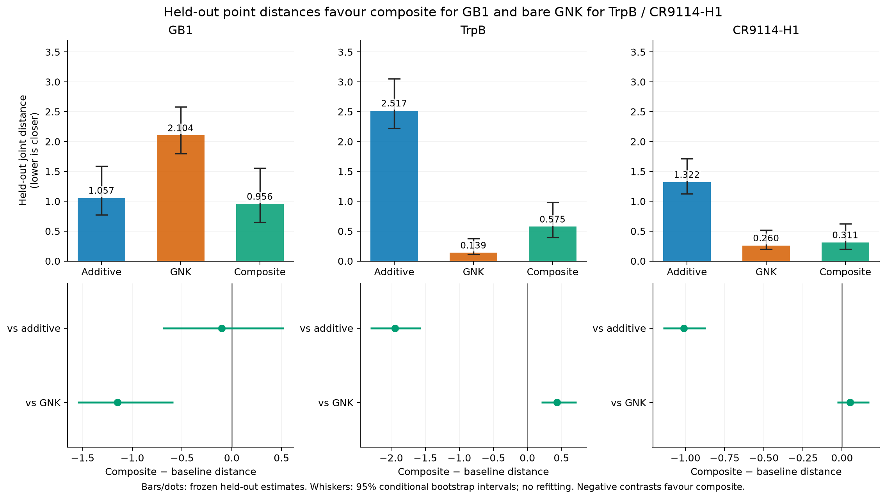
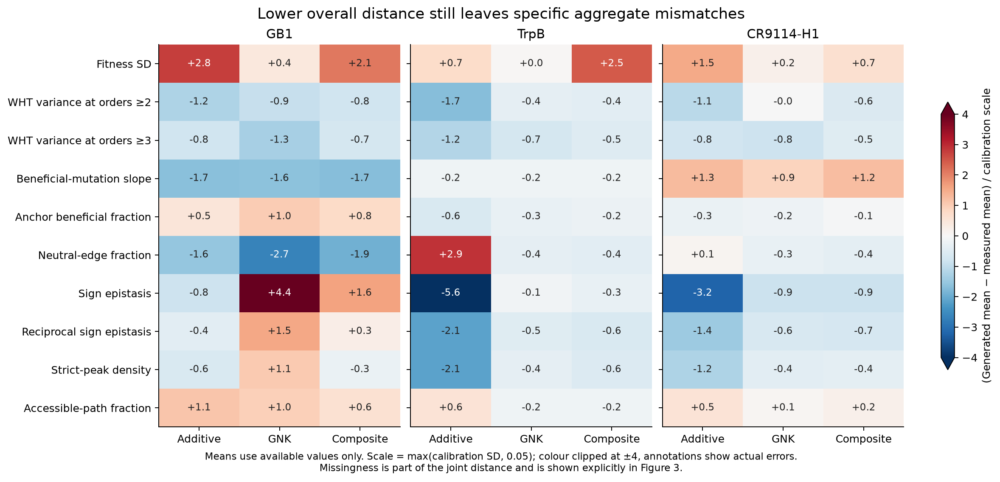
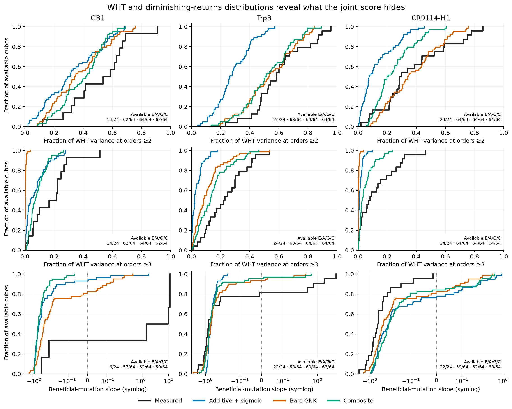
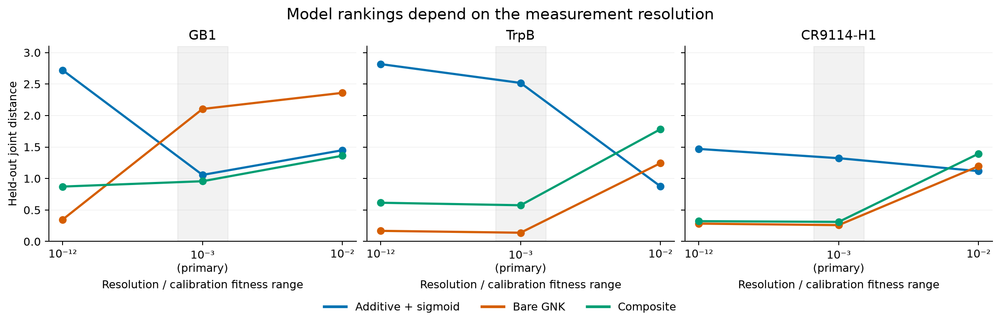
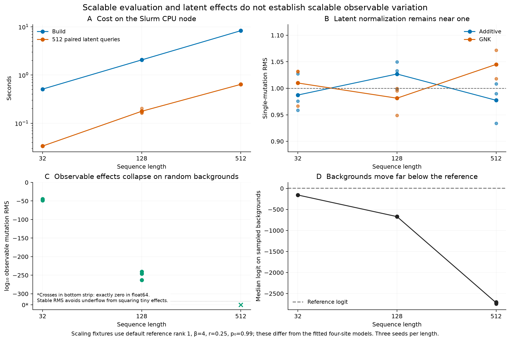

# ANA-063: RUN-164 aggregate thermodynamic GNK confirmation analysis

The composite generator shows partial, assay-dependent recovery of aggregate
landscape statistics. Its held-out joint distance is lowest for GB1; bare GNK is
lowest for TrpB and CR9114-H1. The proposed general advantage over both baselines
is therefore not supported by this run. Large-length evaluation is feasible, but
the separate default-parameter scaling panel loses observable variation through
sigmoid saturation. These are descriptive findings, without inherited pass gates.

Linked experiment: **EXP-065**. Source run: **RUN-164**, Slurm job 2311, exit code 0.
The [executed notebook](notebooks/analysis.ipynb) regenerates all figures and tables.
See [reproduction instructions](README.md) and [machine-readable metrics](tables/metrics.json).

## Design and audit

Each assay contributes 24 calibration and 24 confirmation binary four-site cubes.
All 768 genotypes across its 48 cubes are distinct. Each family is calibrated
separately, then evaluated with eight fresh synthetic seeds and eight cubes per
seed. No empirical interaction identities are fitted. The synthetic comparisons
use four active sites; they do not test whole-protein statistical recovery.

The registered distance compares the joint distribution of ten descriptors,
including WHT variance fractions, beneficial-mutation slopes, neutral edges,
strict peaks and accessibility. Centering and scaling use calibration data only,
with a 0.05 scale floor and explicit missingness coordinates. Primary resolution
is 0.001 of the calibration fitness range. No parameters are refitted here.

The notebook verifies SHA-256 hashes for eight outputs, three logs, six frozen
source files and the three locally available full input tables. It independently
recomputes WHT, beneficial-mutation slopes, neutral edges and strict peaks from
all 144 measured cubes, verifies split/seed separation and selected grid minima,
and reproduces all nine reported joint distances. Full details are in
[audit.json](tables/audit.json).

## Held-out comparison

| Assay | Additive + sigmoid | Bare GNK | Composite |
| --- | ---: | ---: | ---: |
| GB1 | 1.0567 | 2.1039 | **0.9565** |
| TrpB | 2.5173 | **0.1390** | 0.5750 |
| CR9114-H1 | 1.3222 | **0.2598** | 0.3109 |

**Figure 1.** Lower distance indicates closer aggregate agreement under the
registered descriptor weighting. Intervals are conditional 95% bootstrap
percentiles from 2,000 paired resamples of measured cubes and synthetic seed
clusters; each seed retains its eight cubes. They exclude calibration/refitting
uncertainty. Cubes can share sites and alleles despite having distinct genotypes,
so these intervals do not establish population-wide coverage.

Composite minus additive is −0.100 [−0.693, 0.521] for GB1, −1.942
[−2.306, −1.568] for TrpB, and −1.011 [−1.143, −0.871] for CR9114-H1.
Composite minus bare GNK is −1.147 [−1.550, −0.587], +0.436 [0.206, 0.719],
and +0.051 [−0.032, 0.172], respectively. Thus the small GB1 improvement over
additive and CR9114-H1 difference from bare GNK are uncertain within this panel.
These intervals describe differences; they are not new success thresholds.

## Which global statistics are recovered?

**Figure 2.** Synthetic minus measured descriptor means, divided by the
calibration scale used in the joint distance. Colors saturate at ±4; printed
values remain uncapped. This is a mean-error diagnostic, not a decomposition of
the joint distribution distance.

The composite overestimates fitness spread: mean within-cube fitness SD is
0.1709 versus measured 0.0095 in GB1, 0.2005 versus 0.0350 in TrpB, and 0.1310
versus 0.0599 in CR9114-H1. It underestimates the mean high-order WHT fraction
in all three assays. Aggregate distance alone therefore does not establish
simultaneous recovery of the requested global statistics.

**Figure 3.** Empirical cumulative distributions of the WHT variance fractions at
orders ≥2 and ≥3, and of same-mutation slopes for mutations beneficial on average
across their cube backgrounds. Availability counts accompany every panel;
unresolved spectra and unavailable slopes are not assigned zero. Slopes use a
symmetric logarithmic axis to retain extreme values.

GB1 has only 14/24 resolved confirmation spectra and 6/24 available beneficial
slope summaries at primary resolution. Its mean slope is +5.480, versus negative
synthetic means. The measured means for TrpB and CR9114-H1 are −0.362 and −0.672
(22/24 available each). These are conditional slope summaries, not universal
rates of diminishing returns. The GB1 result is especially sparse and
resolution-sensitive; measurement noise, selection and small background variance
can influence it. Independent replicate errors are unavailable, so covariance
correction is not possible. No unique biological mechanism is inferred.

## Resolution sensitivity

**Figure 4.** The same selected parameters evaluated at resolutions 1e−12, 0.001
and 0.01, without retuning. Bare GNK has the lowest distance for all three assays
at 1e−12. At 0.01, additive has the lowest distance for TrpB and CR9114-H1;
composite remains lowest for GB1. The primary ranking is therefore conditional
on measurement resolution. Small numerical distinctions cannot automatically
be treated as experimentally resolved epistasis.

## Computational scaling and observable saturation

**Figure 5.** Three seeds at lengths 32, 128 and 512. Timing uses the original
Slurm node; saturation diagnostics replay the collected source. The scaling
panel uses default reference rank 1, β=4, GNK/additive ratio 0.25 and p₀=0.99,
whereas the empirical comparison uses reference rank 0.5 and fitted parameters.
It is a separate stress test, not a transfer test of those fitted models.

Mean construction time rises approximately 0.51 → 2.06 → 8.30 seconds; 512 paired
latent queries take approximately 0.034 → 0.177 → 0.640 seconds. Additive and GNK
mutation RMS remain near one (0.934–1.072). This supports finite-length
computational feasibility and latent normalization, not arbitrary-length
observable adequacy.

Observable mutation RMS is already only about 10⁻⁴⁹–10⁻⁴⁵ at length 32. The
recorded zeros at length 128 arise from squaring underflow: a stable RMS
calculation recovers approximately 9.37×10⁻²⁶⁴ to 7.11×10⁻²⁴¹. At length 512,
all sampled fitness values and mutation effects are zero in float64. Median
logits move from approximately −157 to −671 to −2718, far below the reference
logit. Thus preserved latent effects do not preserve usable observable effects
under these default settings and random backgrounds.

The replay matches the recorded RMS statistics numerically (relative tolerance
1e−10), but all nine floating-point coefficient fingerprints differ between the
original Linux run and local macOS execution. Both fingerprints are retained in
[scaling_replay.csv](tables/scaling_replay.csv). This is numerical agreement of
the checked statistics, not bitwise reproduction; source hashes do match.

## Scope of the evidence

This run supports an executable synthetic generator and some conditional
aggregate agreement. It does not establish the composite as uniformly superior,
joint recovery of every descriptor, physical identification of folding energies,
specific empirical interactions, whole-protein WHT statistics, or scalable
observable variation. Calibration is a finite grid, and the TrpB composite
selects its minimum β and maximum GNK ratio; this comparison does not establish
the optimum over all possible parameterizations. Bare-GNK offset is not
identified by these translation-invariant descriptors. No RES or CLAIM is
created by this analysis.
