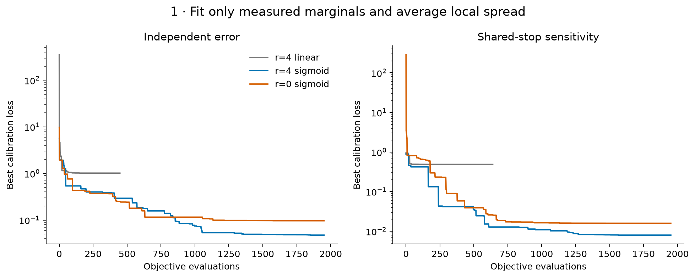
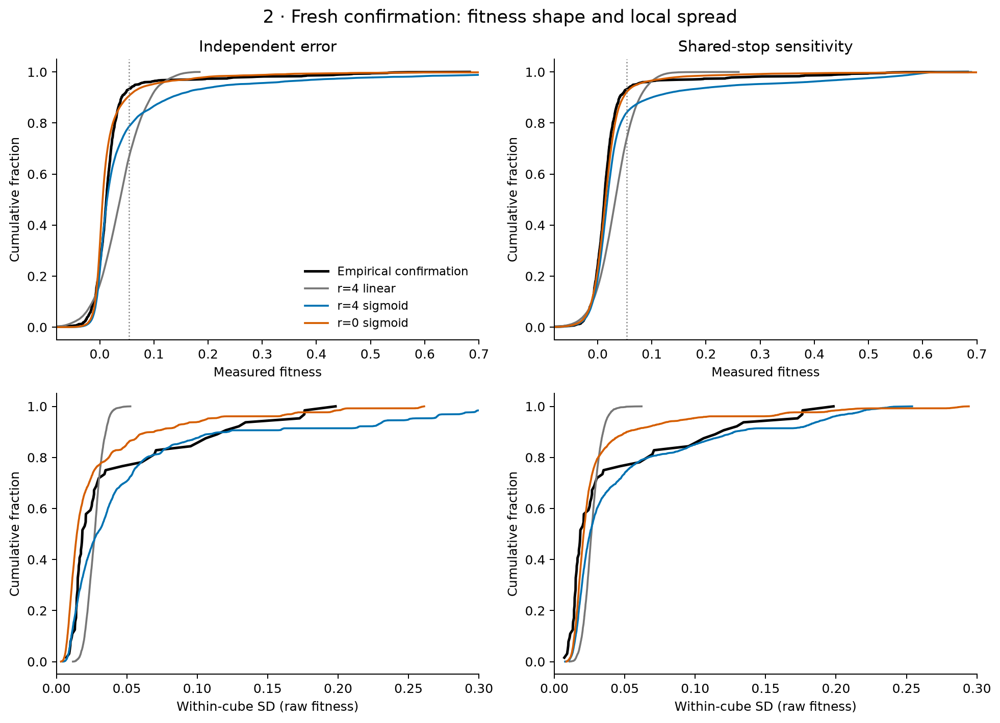
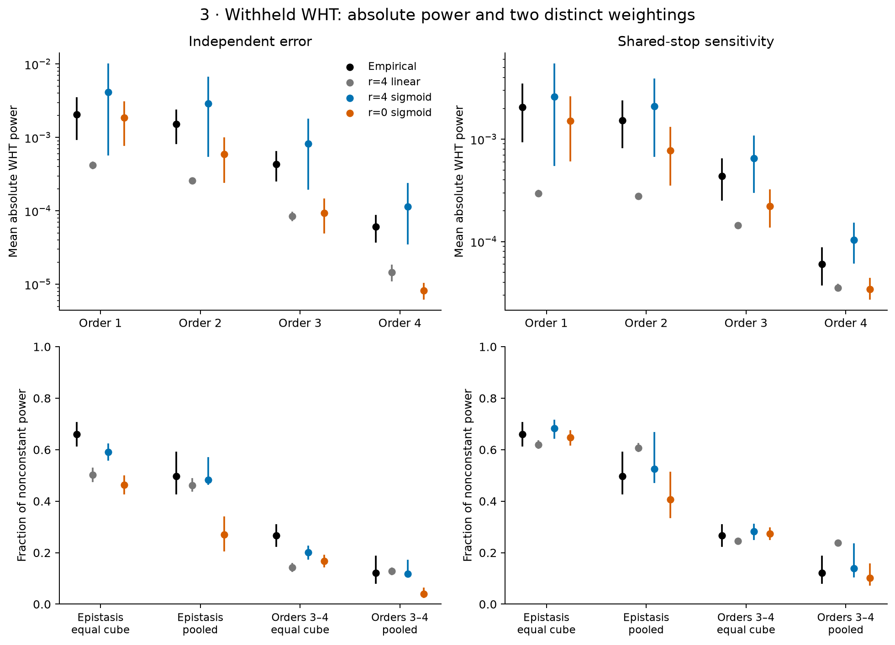
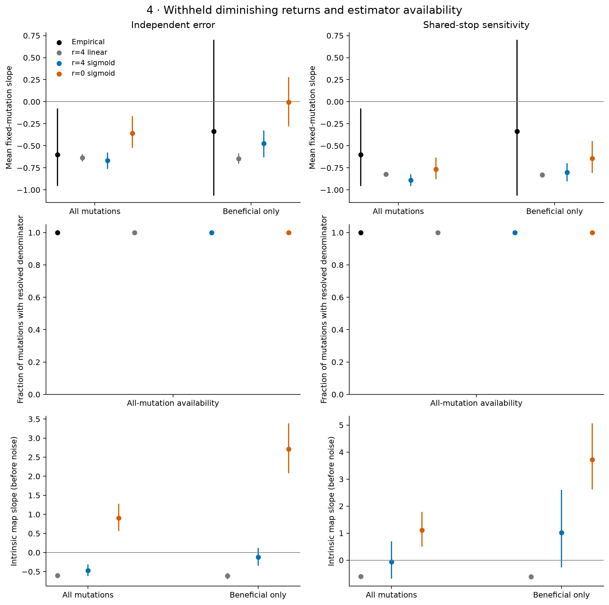
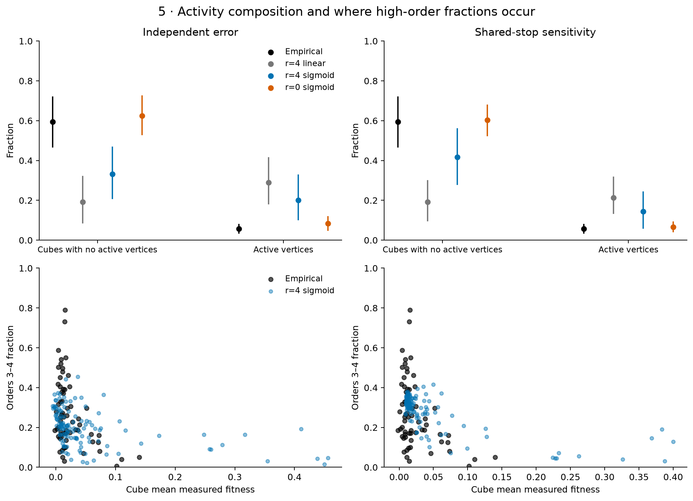

# ANA-066 — Observation-aware global calibration

RUN-170 completed successfully as Slurm job 2314 in 60.86 seconds. Six global
readout fits were selected using measured marginal fitness, near-floor mass and
average local SD. WHT and diminishing-return statistics were withheld. This
analysis asks whether the resulting regimes are useful synthetic analogues for
ML testing, without scientific success gates or specific interaction recovery.

**The result supports using this model family now for a bounded ML pilot.** The
sigmoid readout improves fitness-distribution calibration substantially, and the
r=4 models predict several withheld aggregate statistics reasonably well. This
is evidence for useful parameter regimes, not a uniquely identified biological
mechanism. The strongest observed agreement depends partly on the observation
assumption, and activity prevalence remains imperfect. Those differences should
be documented as properties of benchmark regimes rather than triggering another
open-ended effort to match every descriptor.

The canonical [executed notebook](notebooks/analysis.ipynb) regenerates all five
figures and their PNG/PDF exports, audits saved arrays and exports the numerical
estimates. [Portable settings](tables/portable_parameters.json) include directly
usable `ThermodynamicConfig` dictionaries for all four sigmoid fits. They retain
length 4 and a seed explicitly; changing length remains a separate extrapolation.

## 1. Calibrating with observation noise changes the conclusion

The r=4 sigmoid calibration loss is 0.0475 under independent replicate error and
0.0080 under the shared-stop sensitivity, compared with 1.0157 and 0.4871 for the
corresponding linear controls. The additive sigmoid control reaches 0.0966 and
0.0159. These losses combine normalized quantile error, mean-SD error and
near-floor CDF error; **they are not scores for withheld epistasis or slopes**, nor
formal evidence for one noise model over another. Each branch assumes a
different observation process whose donor parameters were frozen beforehand.

There are 64 fresh calibration and 64 confirmation empirical cubes, with no
shared genotype between panels or the old 1,664 exposed nodes. All 3,712 old/new
nodes are excluded from noise donors. Eight calibration and sixteen confirmation
synthetic landscape seeds are separate. The 32 evaluation noise draws per cube
are repeated measurements, not additional independent landscapes.

All sigmoid optimizations used their finite 60-iteration budget without meeting
the optimizer's numerical convergence criterion. The independent-error sigmoid
fits and shared-error additive fit approach the scale bound of 2. These are
reproducible candidate parameter sets, not proofs of optimality or identifiable
thermodynamic parameters. Finding useful settings does not require searching
until every parameter or summary is perfect.

| Observation assumption | Map | Offset b | Scale c | Position mu | Steepness beta |
|---|---|---:|---:|---:|---:|
| Independent error | r=4 linear | 0.02902 | 0.00811 | — | — |
| Independent error | r=4 sigmoid | −0.00597 | 1.98300 | −5.04387 | 0.31217 |
| Independent error | r=0 sigmoid | −0.00301 | 1.99888 | −5.80159 | 1.20054 |
| Shared-stop sensitivity | r=4 linear | 0.02678 | 0.00545 | — | — |
| Shared-stop sensitivity | r=4 sigmoid | 0.01085 | 0.60014 | −7.47492 | 0.72202 |
| Shared-stop sensitivity | r=0 sigmoid | 0.00911 | 1.99947 | −7.37440 | 1.57682 |

The sigmoid map is `b + c sigmoid(mu + beta (A + r G))`; the linear map is
`b + c (A + 4 G)`. The rank, support construction and order weights remain fixed.
No per-cube adjustment or empirical genotype-to-fitness map was fitted.

## 2. Marginal resemblance transfers imperfectly, with substantial seed variation

The sigmoid models reproduce the concentration of measured values near the assay
floor and the broad spread of local variability much better than the linear
control. The full distribution of cube SD was not a fitting target. Axes in this
figure zoom on the main mass (fitness to 0.7; SD to 0.3); calculations retain every
value, including tails outside the display.

Mean empirical within-cube SD is 0.0423 on confirmation, compared with 0.0295 on
calibration. The confirmation r=4 sigmoid SD is 0.0547 under independent error and
0.0500 under shared-stop error, with wide seed intervals: [0.0297, 0.0902] and
[0.0301, 0.0728]. The empirical cube interval is [0.0313, 0.0544]. Thus both the
empirical and synthetic panels vary materially. Overlap is descriptive; it does
not establish statistical equivalence, and no equivalence threshold was defined.

## 3. Withheld aggregate epistasis is close in several useful senses

| Confirmation descriptor | Empirical | r=4 sigmoid, independent | r=4 sigmoid, shared-stop |
|---|---:|---:|---:|
| Equal-cube epistatic fraction, orders 2–4 | 0.660 | 0.591 | 0.683 |
| Pooled epistatic fraction, orders 2–4 | 0.496 | 0.483 | 0.525 |
| Equal-cube high-order fraction, orders 3–4 | 0.267 | 0.200 | 0.283 |
| Pooled high-order fraction, orders 3–4 | 0.121 | 0.118 | 0.139 |

The independent-error model gets pooled allocation close while undershooting
mean per-cube high-order fraction. The shared-stop r=4 setting brings both
weightings closer at once. Its mean per-cube interval is [0.253, 0.309], alongside
empirical [0.226, 0.308]; pooled intervals are [0.108, 0.233] and [0.083, 0.185].
Absolute powers, shown above, still differ and are seed-variable. Agreement in
fractions alone must not obscure amplitude differences.

The r=0 shared-stop control also gives an observed equal-cube high-order fraction
of 0.274. Its intrinsic value is only 0.047, compared with 0.218 for the r=4
shared-stop fit. That control prevents attributing all observed aggregate
resemblance to a rich latent biological landscape. Conversely, the intrinsic
r=4 independent-error fit already has pooled high-order fraction 0.116, close to
its observed 0.118 and empirical 0.121. Latent structure and observation both
matter; their contributions are not identified uniquely by these summaries.

## 4. Diminishing returns are plausible observationally, but not uniquely biological

The all-mutation slope is −0.599 empirically, −0.667 for the independent-error
r=4 sigmoid and −0.890 under shared-stop error. The corresponding beneficial-only
slopes are −0.335, −0.474 and −0.800. Empirical uncertainty is broad: the all-mutation
interval is [−0.949, −0.084], while the beneficial interval is [−1.057, +0.695].
The earlier panel's roughly −1.03 beneficial slope is therefore not a precise
universal target. This is variation between sampled cubes of the same assay,
not evidence that the empirical biological mechanism changed.

The bottom row is essential for ML interpretation. Before observation noise,
r=4 independent-error calibration gives slopes −0.476 (all) and −0.124
(beneficial); r=4 shared-stop calibration gives −0.062 and +1.018. The latter
observed diminishing returns therefore do **not** establish equally strong
intrinsic diminishing returns. A negative observed slope can arise partly from
shared-baseline coupling in the slope calculation: the measured background
appears with opposite sign inside the measured mutation effect. Independent
replicate error and truly shared error affect that coupling differently.

Cross-replicate empirical estimates are mean high-order 0.258, pooled 0.118,
all-mutation slope −0.501 and beneficial slope −0.140. Stop-adjustment again
produces unstable individual ratios: mean high-order −0.023 with interval
[−1.255, 0.937], and only 41% of mutation denominators remain resolved. These
signed corrections are retained in the [full table](tables/confirmation_estimates.csv)
and raw numerator/denominator arrays, never clipped or treated as unique
noise-free biological truth. Primary ordinary denominators resolve all 256
empirical mutation directions; cross-replicate availability is 97%.

## 5. The remaining mismatch is concrete, not a reason to demand perfection

Only 5.76% of empirical confirmation vertices are active, and 59.4% of cubes
contain none. The r=4 independent-error fit gives 20.0% active vertices and 33.2%
no-active cubes; the shared-stop fit gives 14.4% and 41.7%. In particular, the
latter still generates about 2.5 times the empirical active fraction on this
panel. The r=0 shared-stop control is closer at 6.52% and 60.3%, but has much less
intrinsic high-order structure. There is no single dominant setting across every
descriptor.

Activity requires both measured replicates above their published cutoffs. The
fitted floor target used the replicate-average CDF; the joint activity composition
and conditional allocation of variance were withheld. The distinction matters:
fitting a marginal distribution does not guarantee the same arrangement of
active values across cubes. The lower panels show where residual structure
occurs without trying to reconstruct particular empirical interactions.

## Scientific interpretation and proportionate next step

This is enough evidence to treat the existing family as a useful source of
**candidate empirical-like benchmark regimes**, rather than to keep adding
latent mechanisms until every statistic matches. I would retain both r=4 sigmoid
settings and the additive sigmoid control, with the observation assumptions
explicitly attached. The independent-error r=4 setting is the clearer starting
point if the ML objective is improvement of an intrinsic biological landscape:
it retains negative intrinsic all-mutation slopes and appreciable intrinsic
high-order power. The shared-stop r=4 setting is useful for testing behavior
under an assay process that gives closer observed spectral resemblance. It is
not a uniquely calibrated reconstruction of the true TrpB landscape.

The next experiment should be one small pilot of the actual online ML task,
using fixed budgets and sampling policies: random search, a simple local search
baseline and one ML acquisition policy on empirical four-site data and these
frozen synthetic regimes. Compare learning curves, attainable improvement and
strategy ordering. On synthetic data, score true intrinsic fitness separately
from noisy observations, so learning the noise is not rewarded. Empirical
replicate-average fitness is an assay reference, not known error-free truth.
Broader lengths can be exercised for computational behavior, but empirical
statistical transfer should remain conditional on the sampled neighbourhoods.
Only change latent architecture if a specific residual demonstrably distorts the
ML behavior the environment is meant to test. This next step is a recommendation,
not a further submitted RUN.

This interpretation is consistent with [Otwinowski, McCandlish & Plotkin (2018),
*Inferring the shape of global epistasis*](https://doi.org/10.1073/pnas.1804015115):
readout nonlinearity, additional epistasis and measurement variation need to be
distinguished. [Reddy & Desai (2021), *Global epistasis emerges from a generic
model of a complex trait*](https://doi.org/10.7554/eLife.64740) motivates aggregate
predictions without identifying microscopic interactions. These papers support
the model class and controls; neither makes these fitted latent coordinates
measured thermodynamic quantities.

## Reproducibility and limits

The notebook independently checks 103 output hashes, 212 remotely hashed files,
seven submitted source hashes, 2,048 empirical genotype measurements and all
3,712 donor exclusions. A butterfly WHT and separate covariance implementation
recompute 114,432 statistic rows from 38,144 replicate-pair cubes. An independent
observation replay checks 1,179,648 synthetic replicate values and reproduces all
six selected calibration objectives and their best recorded search values.
Twelve numerical tests and a smoke run on old exposed cubes preceded submission.

Intervals use 1,000 empirical-cube or synthetic-seed bootstrap resamples. They
condition on fitted parameters, donor calibration and this previously examined
assay; they do not include refitting uncertainty or establish new-assay transfer.
Complete-cube rejection and old-node exclusion define the empirical sampling
population. Sigmoid searches are finite and some scales reach their bound.
Shared-stop covariance remains an assumption confounded by controls and shared
assay processing. Four-site results do not establish invariant global statistics
at arbitrary sequence length. None of these limitations prevents using clearly
labelled, imperfect model regimes for the intended ML tests.

The [README](README.md) supplies execution and DVC restoration instructions.
There is no new RES or CLAIM, and no repository-wide strict-check pass is claimed:
historical cloud-backed records timed out during broad checks. Targeted RUN,
notebook, artifact and numerical checks are recorded instead.
