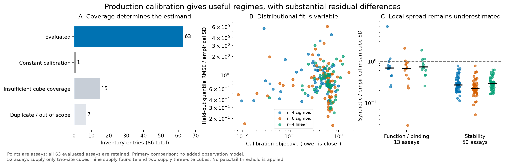
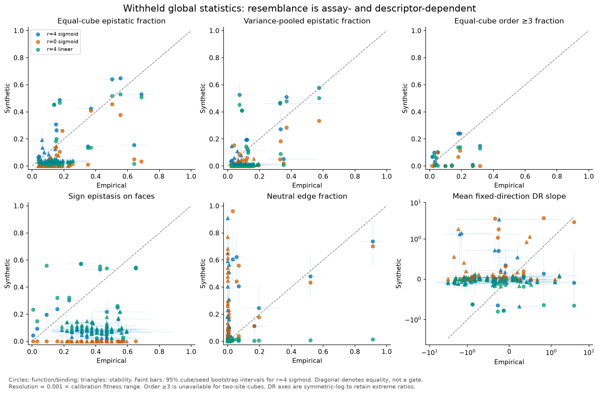
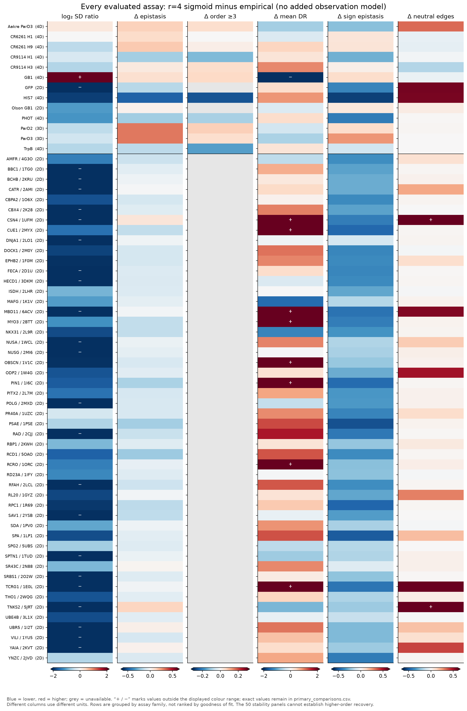
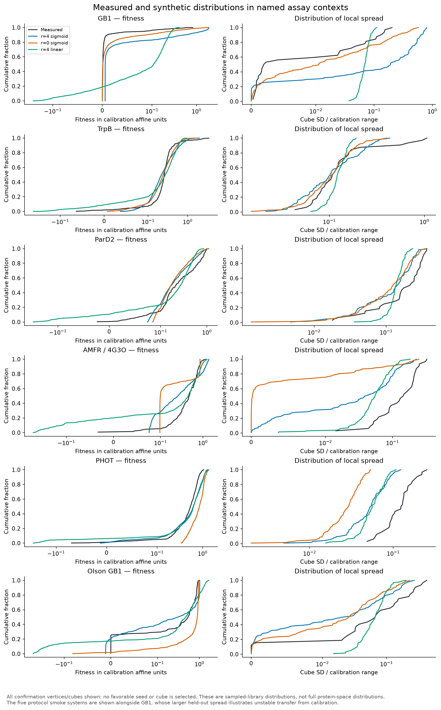
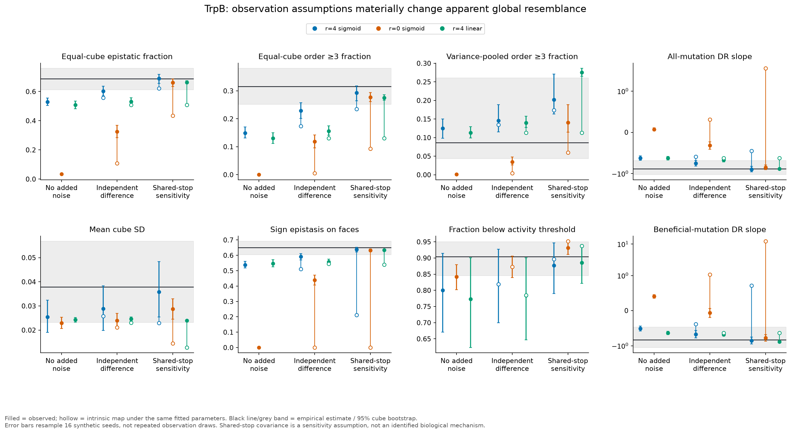
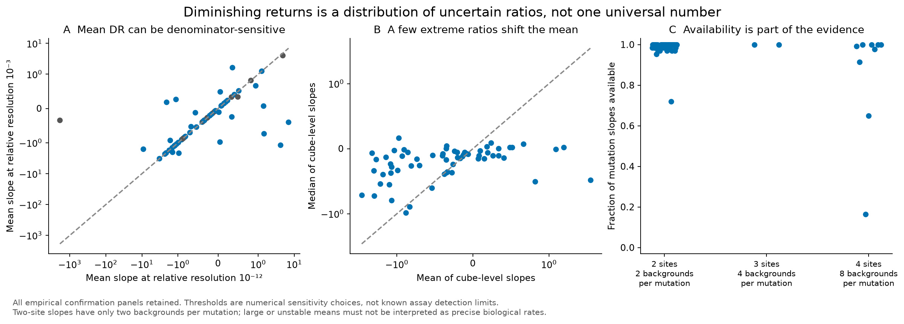

# ANA-067: Production landscape aggregate realism

The production experiment establishes useful conditional regimes, but the fixed
r=4 calibration recipe does not make every assay class globally empirical-looking.
TrpB is the clearest observed-fit example when its observation process is included.
Across the broader panel, local fitness variation and sign epistasis expose
substantial differences that are hidden by plausible marginal distributions.
These are differences to understand, not scientific pass/fail decisions.

This analysis is produced by [the executable notebook](notebooks/analysis.ipynb).
All six figures have PNG and PDF exports; exact estimates and bootstrap intervals
are in [aggregate_estimates.csv](tables/aggregate_estimates.csv). The source code,
configuration, raw cubes and selected parameter settings are preserved with the
DVC-tracked production data. No empirical interaction identities were fitted.

## Figure 1 — Scope and calibration

RUN-172 evaluated 63 assays: 13 function/binding readouts and 50 stability panels.
Nine supply four-site cubes, two three-site cubes and 52 two-site cubes. Only the
first 11 can inform order-three-or-higher WHT fractions. Related antigen assays
and stability panels are not 63 independent biological mechanisms.

The complete inventory has 86 entries: 63 evaluated, one constant calibration
panel (CR9114 FluB), 15 without enough complete disjoint cubes within the sampling
budget, and seven duplicate/out-of-scope entries. The derived inventory restores
the final three excluded FLIP rows omitted by the RUN's CSV flush. No frozen
scientific values were changed, and no unfavorable assay was dropped for fit.

The r=4 sigmoid has lower calibration loss than the linear control in 51/63
assays, but lower held-out marginal quantile error in only 33/63. The median
held-out quantile RMSE divided by empirical SD is 0.593 for functional assays
and 0.833 for stability panels. These are descriptive errors, not thresholds.

A stronger limitation is local spread: the median synthetic/empirical mean cube
SD ratio is **0.696 for functional assays and 0.270 for stability panels**. Thus
many stability landscapes are much flatter locally than the measured panels,
even though a global fitness distribution can look plausible. GB1 goes in the
other direction: its held-out mean cube SD is 6.95 times the empirical value,
illustrating sensitivity to sampled cubes and fresh generator seeds.

## Figure 2 — Withheld global statistics

At the primary numerical resolution (0.001 × calibration fitness range), the
r=4 sigmoid's median absolute error in equal-cube epistatic fraction is 0.159
for functional assays and 0.078 for stability panels. Those errors alone do not
capture the whole landscape. Among the 50 stability panels, median empirical
versus synthetic sign-epistasis prevalence is **0.394 versus 0.078**, and median
mean DR slope is **−0.398 versus −0.004**. Their median epistatic fractions are
0.105 versus 0.031. The model often supplies too little resolved local structure.

The additive sigmoid can generate magnitude epistasis but has no intrinsic sign
epistasis. The synthetic GNK component therefore adds a meaningful capability;
its usefulness does not imply that a fixed r=4 produces the empirical rate of
ruggedness in every geometry. The linear control is an analysis-only comparison,
not another public production method.

WHT fractions are reported both equally over resolved cubes and by pooled power.
These estimands differ because high-variance cubes receive more influence in the
pooled statistic. A model can resemble one without resembling the other.

## Figure 3 — Every evaluated assay

All evaluated assays remain visible. PHOT's equal-cube epistatic fraction is
0.233 empirically versus 0.024 synthetically; HIS7 is 0.641 versus 0.155.
Their sign-epistasis prevalences are approximately 0.467 versus 0.046 and
0.572 versus 0.010, respectively. These are substantial residual differences,
not a demand for a perfect model. Several antibody contexts are closer on
particular descriptors, but no single fixed arm dominates every statistic.

The r=0 and r=4 comparisons test two interaction settings, not the entire
continuous parameter space of the public model. This experiment cannot prove
that no intermediate or differently calibrated setting would be useful. It
also cannot establish empirical statistical invariance as sequence length grows.

## Figure 4 — Fitness distributions and local spread

The five protocol smoke systems are shown alongside GB1, explicitly added to
illustrate its unstable transfer. Curves use every confirmation cube/seed;
there is no selection of favorable synthetic sequences. Their coordinates are
scaled only by calibration quantities. Similar marginal curves should not be
mistaken for recovery of local fitness differences or interaction structure.

All comparisons are conditional on measured library coverage. Sparse libraries
use measured anchors and reversion/alternative-allele cubes; the model uses the
same geometries with random fields. The represented length is the number of
variable library sites, not full protein length. Stability panels are two-site
comparisons and do not supply higher-order validation.

## Figure 5 — TrpB gives a concrete, qualified positive result

For the r=4 shared-stop observation sensitivity, confirmation gives:

| Statistic | Empirical | Synthetic observed |
|---|---:|---:|
| Equal-cube epistatic fraction | 0.688 | 0.689 |
| Equal-cube order ≥3 fraction | 0.316 | 0.293 |
| All-mutation DR slope | −0.880 | −0.896 |
| Mean cube SD | 0.0379 | 0.0358 |
| Sign-epistasis prevalence | 0.651 | 0.638 |

The 95% bootstrap intervals overlap for these comparisons. For example, the
high-order fractions are 0.252–0.381 empirically and 0.265–0.318 synthetically;
DR intervals are −1.061 to −0.682 and −0.959 to −0.823. Overlap is uncertainty
information, not a test of equivalence or a scientific success gate.

This is a useful existence demonstration of global resemblance without fitting
specific interactions. It remains qualified. Pooled high-order fraction is
0.086 empirically versus 0.202 synthetically (empirical interval 0.044–0.260),
so agreement is less convincing when high-variance cubes dominate. The fraction
below the activity threshold is 0.904 versus 0.877.

More fundamentally, observation and intrinsic structure differ. The r=4
shared-stop intrinsic all-mutation slope is −0.451, compared with −0.896 after
observation. Its intrinsic sign-epistasis prevalence is 0.212, compared with
0.638 observed. Even the additive shared-stop control achieves an observed
high-order fraction of 0.277, while having zero intrinsic sign epistasis.
Observed resemblance is therefore not proof that the intrinsic biological
landscape or a unique noise model has been recovered.

The independent-difference r=4 branch supplies an intermediate result:
epistatic fraction 0.603, high-order fraction 0.229 and DR slope −0.753.
The production data retain both sensitivities and the noiseless maps separately.

## Figure 6 — DR means can be unstable

Two-site cubes have only two backgrounds per mutation. A near-zero denominator
can generate a very large slope; changing numerical resolution or using a median
can materially alter the summary. For example, GB1's empirical mean cube slope
is +4.023 at primary resolution, but its median is −0.480. Neither is a universal
biological diminishing-returns constant. The analysis reports availability,
resolution sensitivity and medians alongside the requested mean statistics.

The independent centered FWHT audit found 65 fraction entries sensitive to
floating-point cancellation only at the smallest numerical resolutions
(≤3.31e−12 raw units). The largest absolute discrepancy was 1.10e−5, within
propagated roundoff bounds; corresponding cube SDs were ≤1.70e−9. This does not
alter the primary-resolution conclusions. Raw powers and these diagnostics are
retained rather than treating tiny-variance fractions as precise evidence.

## Interpretation for the scientific aim

The evidence supports the public model as a controlled synthetic family with
some demonstrably useful empirical regimes. It does **not** support a blanket
claim that the fixed production calibration yields broadly interchangeable
empirical landscapes. That distinction does not demand perfection: the key
limitations are systematic local flattening and missing sign structure in whole
parts of the panel, not small disagreements in every last statistic.

The thermodynamic-like coordinate and nonlinear readout are a defensible
abstraction; these results do not identify physical free energies. This is
consistent with [Otwinowski, McCandlish & Plotkin (2018)](https://doi.org/10.1073/pnas.1804015115)
on nonlinear global epistasis, and [Reddy & Desai (2021)](https://doi.org/10.7554/eLife.64740)
on global patterns emerging from complex interactions. Aggregate statistics alone
cannot uniquely distinguish these mechanisms.

This ANA does not evaluate ML policies or adaptive-search performance. Its useful
claim is conditional aggregate resemblance for synthetic benchmarking, with
observation assumptions and residual differences made explicit. It does not fit
actual empirical interactions, assert a single universal parameter set, or impose
new scientific success gates.

## Reproducibility and uncertainty

- Notebook: ten executed code cells, six inline figures, PNG/PDF exports.
- Raw output audit: 1,819 hashes; frozen source audit: 12 hashes.
- Independent numerical checks: 179,310 statistic rows, 23,016 empirical nodes,
  230,400 cached intrinsic readout values, and public API replay on all 63 assays.
- All 195 selected objectives match recomputation and the minima of their saved
  optimizer traces. Only 76/195 searches report optimizer convergence; 47/195
  settings are within 1% of at least one bound. These are finite candidates.
- Intervals use 1,500 bootstrap draws over empirical cubes or synthetic seeds.
  They condition on sampling and fitted parameters, omit calibration/refit
  uncertainty, and do not treat related assays as independent replications.
- TrpB observation donors exclude all selected cube genotypes. Other assays lack
  a matched observation model, so fitted intrinsic maps can absorb assay noise.
- DVC bundle: `data/processed/production_landscapes/RUN-172.dvc`; directory MD5
  `521d0e1b381ead592b0f47504e0f13ba.dir`. Its 1,842 files include frozen outputs,
  exact source and execution provenance. Remote object verification is recorded
  in `tables/data_bundle_audit.json`.
- Broad labproj status/refresh/check commands timed out on existing cloud-backed
  historical records. Targeted dataset, source, numerical and notebook audits
  were completed. No new RES or CLAIM record is created.
