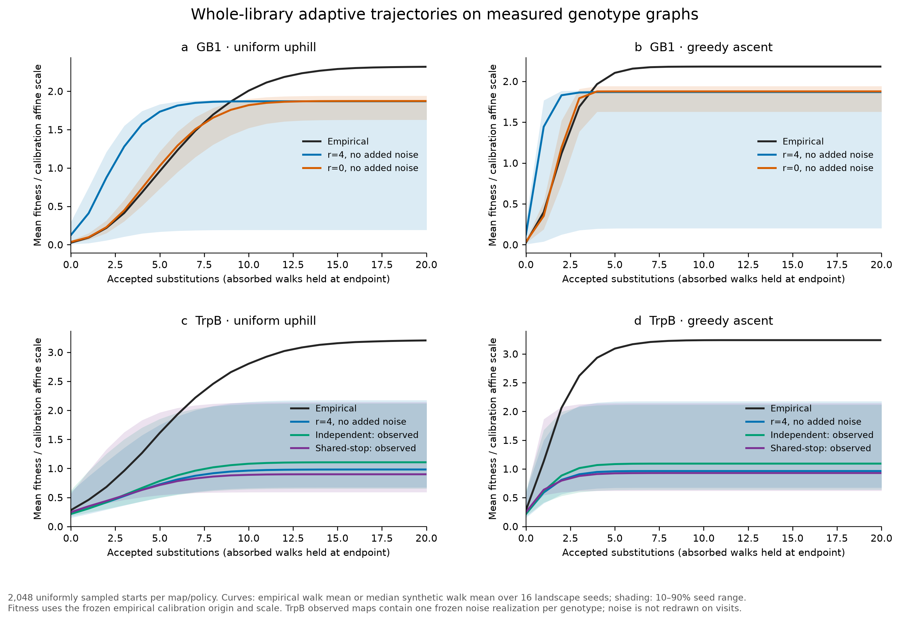
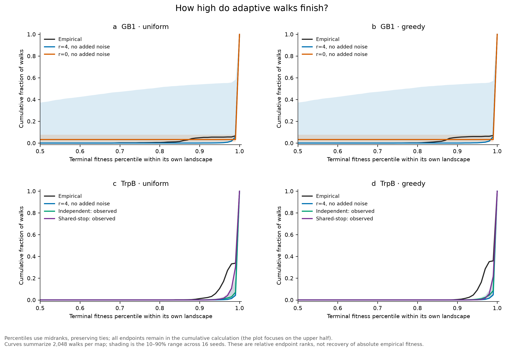
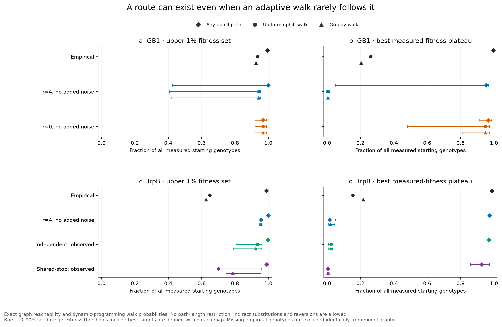
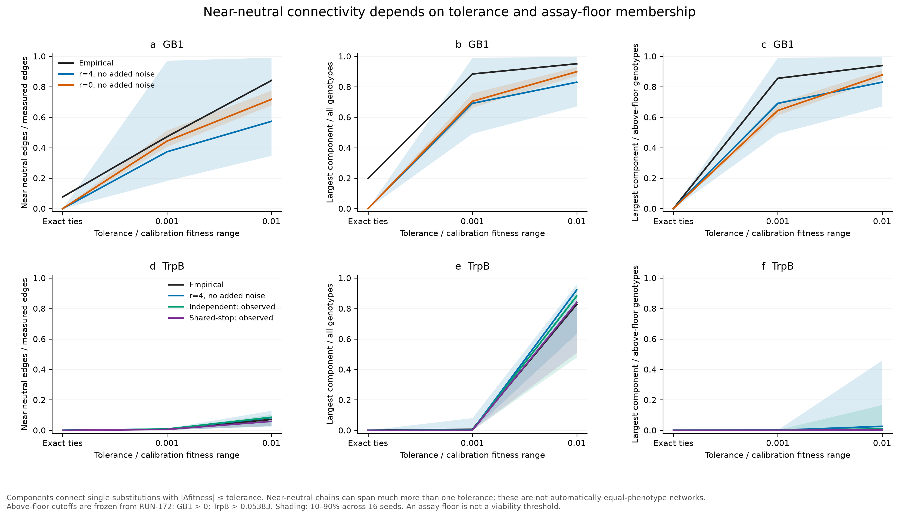
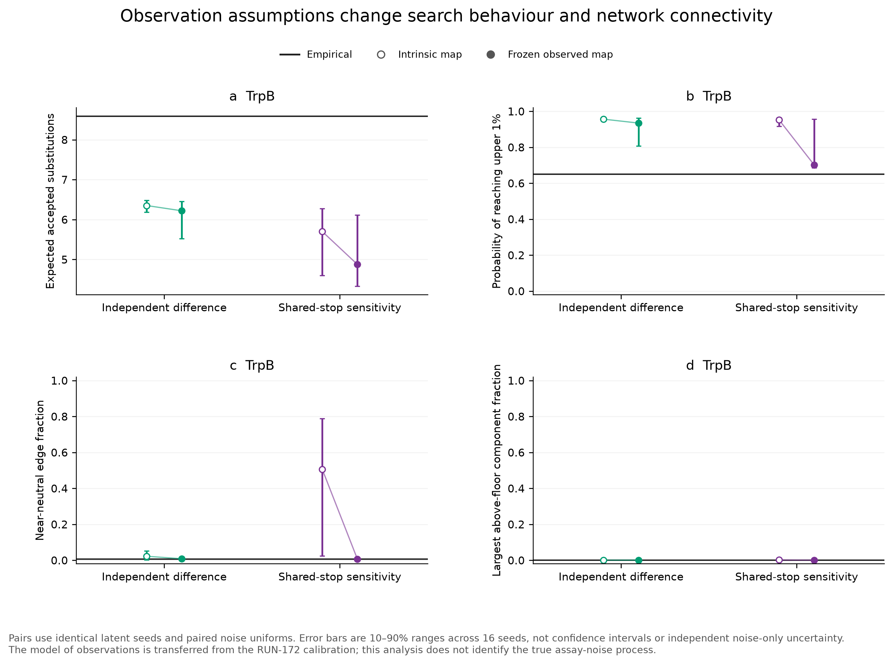
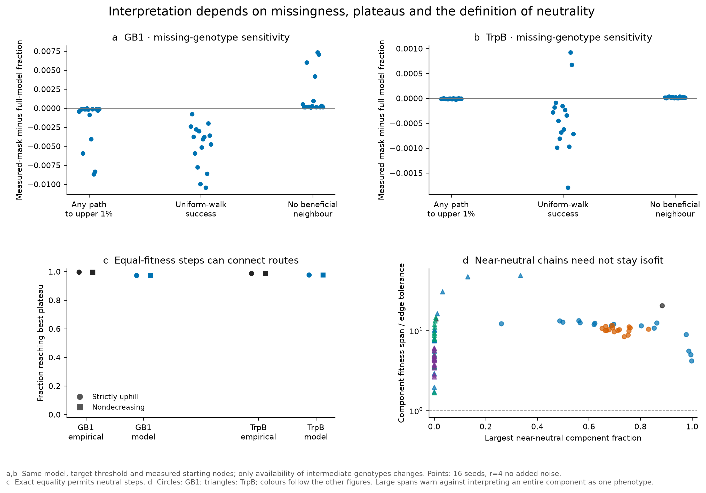

# ANA-068 — GB1 and TrpB adaptive walks, accessibility and neutral connectivity

The current model provides broadly accessible high-fitness regions, but its
adaptive walks are shorter and its basins of attraction differ from the empirical
landscapes. TrpB's shared-stop observation sensitivity brings the probability of
reaching the upper 1% closer to empirical, while changing other aspects of search.
Neutral connectivity is strongly dependent on tolerance and assay-floor treatment.
These are mechanistic consequences of the existing fits, not new fitted targets.

The [executed notebook](notebooks/analysis.ipynb) regenerates all calculations and
six figures. The [protocol](protocol.md) was written before whole-library analysis.
Parameters and all 16 model seeds are reused from EXP-066 / RUN-172. No new RUN,
model fitting, RES, CLAIM or scientific success gate is introduced.

## What was already available?

ANA-020 / RES-020 contains adaptive-walk results for an older model, with partial
support for deceleration but other biological mismatches. ANA-063 and ANA-064
contain accessibility fractions and neutral-edge summaries on small measured
cubes. Those results are not whole-library adaptive walks or neutral networks for
the current production model. ANA-068 fills that specific gap for GB1 and TrpB.

## Graph definition and scope

Both four-site spaces contain 160,000 possible amino-acid genotypes. A node has
76 possible single-substitution neighbours; the full graph has 6,080,000
undirected edges. GB1 retains 149,361 measured nodes and 5,492,805 edges; TrpB
retains 159,129 nodes and 6,016,433 edges. Synthetic maps use the same observed
node mask as the corresponding empirical map. No missing value is imputed.

Only 18.1% of GB1 nodes have all 76 neighbours measured, compared with 81.9% for
TrpB, despite high overall library coverage. The mean measured degrees are 73.55
and 75.62. Consequently, all empirical optima and routes are conditional on the
observed graph. Edges represent amino-acid substitutions, not single-nucleotide
mutations or a codon mutation spectrum.

Primary resolution is epsilon = 0.001 × the frozen empirical calibration range.
Sensitivity analyses use exact comparisons and 0.01 × range. These are numerical
resolutions, not measured selection coefficients or assay error estimates.

The whole-library extension includes earlier calibration genotypes and noise
donors. It is a descriptive post-fit assessment, not a new independent validation
sample. Across-seed bands represent generator variability with fixed parameters;
they omit fitted-parameter and empirical measurement uncertainty.

## Figure 1 — Adaptive trajectories

Uniform uphill walks choose equally among beneficial neighbours; greedy walks
choose the highest-fitness neighbour, breaking exact ties uniformly. Fitness
increases must exceed epsilon. Walks start uniformly over retained nodes.
Substitutions are not generations or waiting times. Dynamic programming provides
exact expectations, and 2,048 walks per map/policy provide the plotted trajectories.

At primary resolution:

| Landscape | Uniform uphill: expected substitutions | Greedy: expected substitutions |
|---|---:|---:|
| GB1 empirical | 9.74 | 4.09 |
| GB1 r=4, no added noise | 5.27 | 2.17 |
| TrpB empirical | 8.59 | 3.47 |
| TrpB r=4, no added noise | 6.37 | 2.67 |
| TrpB independent observed | 6.22 | 2.59 |
| TrpB shared-stop observed | 4.87 | 1.95 |

Synthetic entries are medians across 16 seeds. These fits tend to terminate sooner
than the empirical maps. Matching local WHT fractions does not guarantee matching
the sequence of improvements encountered by a walk. The raw trajectory scale also
retains differences in whole-library fitness distributions.

## Figure 2 — Endpoints

Both empirical and synthetic walks often finish high in their own landscape's
fitness ranking. That is a useful broad resemblance, but within-map percentile
normalization does not establish comparable absolute fitness. Fitness ties use
midranks. The plot focuses on the upper half of ranks while its cumulative values
include all endpoints, including low-rank stalled walks.

The r=0 control can produce long uphill paths yet concentrate outcomes at one
accessible high-fitness region. Walk length alone therefore does not establish
realistic ruggedness or basin structure.

## Figure 3 — Route existence versus actually following the route

Accessibility permits indirect routes and reversions, with no path-length cap.
A route can exist even when the probability of taking it is small. The upper 1%
set and the best plateau are defined within each map; ties are retained.

| Landscape | Any uphill path to upper 1% | Uniform-walk success, upper 1% | Uniform-walk success, best plateau |
|---|---:|---:|---:|
| GB1 empirical | 99.59% | 93.54% | 26.10% |
| GB1 r=4, no added noise | 99.83% | 94.24% | 0.33% |
| TrpB empirical | 98.81% | 64.98% | 15.51% |
| TrpB r=4, no added noise | 99.92% | 95.65% | 1.67% |
| TrpB independent observed | 99.79% | 93.46% | 2.38% |
| TrpB shared-stop observed | 99.05% | 70.12% | 0.52% |

Synthetic medians should not hide variability. For GB1, the 10th–90th percentile
range of upper-1% uniform-walk success is approximately 41–95%, despite the close
median. The public recipe does not reliably produce the same search difficulty
for every seed.

For GB1, reaching some very fit genotype is broadly comparable, while reaching
the single best plateau is much less likely in the synthetic maps. For TrpB,
the noiseless model makes the upper 1% too easy to reach under these walk rules.
Shared-stop observations bring uniform-walk success closer (70% versus 65%), but
greedy success is 79% versus 63%, and walks remain shorter. Thus policy choice
matters to the comparison even without testing an ML policy.

The best-plateau comparison is an intentionally stricter diagnostic of basin
structure; it is sensitive to an extreme value and is not a demand that a useful
benchmark reproduce one exceptional empirical optimum.

## Figure 4 — Neutral networks are tractable, but their meaning needs care

At exact equality, GB1 has a connected component of **29,477 genotypes**, or
**19.74%** of measured nodes. Every member is at the zero-fitness floor. It is a
measured plateau, not evidence that these genotypes retain the same useful
molecular function. Exact ties above the GB1 floor form only tiny components.
TrpB has essentially no exact-tie connectivity, as expected for a continuous,
noisy assay readout. Absence of exact numerical ties is not evidence against
biological neutrality.

At the primary nonzero tolerance, GB1's largest component includes 88.4% of all
nodes and its largest above-floor component includes 85.5% of above-floor nodes.
The r=4 noiseless model medians are 69.1% for each; its fitted GB1 lower bound is
positive, so it has no counterpart of the empirical zero-fitness floor.

For TrpB, the empirical largest near-neutral component is only 0.68% of all nodes;
above the activity cutoff it is 0.045% of above-floor nodes. The shared-stop
intrinsic map has a large near-neutral low-fitness component (median 87.9% of
all nodes), which largely disappears after observation (about 0.02%). Observation
noise can destroy graph connectivity even while improving some global summaries.

These components connect individually small-effect edges. They can chain through
a range much wider than epsilon: GB1's primary largest component spans about
0.0718 fitness units, roughly 25 edge tolerances. They must not be interpreted as
networks in which every pair of genotypes has equal fitness or the same phenotype.

## Figure 5 — Observation changes dynamics

Intrinsic and observed results use matched latent seeds. Each observed genotype
receives one fixed replicate-mean observation for the entire analysis. This is
appropriate for comparing static measured maps; it is not the process produced
by independently redrawing noise at every online evaluation.

The shared-stop observation assumption changes basin probabilities, walk lengths
and neutral connectivity. The agreement seen in ANA-067 therefore cannot by itself
identify intrinsic biological search dynamics. The independent-difference and
shared-stop branches remain explicit sensitivities, not competing claims of a
uniquely correct measurement model.

## Figure 6 — Missingness, exact plateaus and neutral chaining

The mask sensitivity holds each model's fitness values, target threshold and
measured starting nodes fixed. It then allows or removes the unmeasured
intermediate nodes. For the common r=4 fit, the median loss in upper-1%
uniform-walk success from applying the mask is about **0.39 percentage points
for GB1** and **0.04 points for TrpB**. The actual missing empirical values remain
unknown. These model sensitivities do not justify filling them in, but suggest
that the mask alone does not explain the much larger dynamical discrepancies.

Allowing exact equal-fitness steps increases empirical best-plateau accessibility
only slightly in these graphs. More broadly, the comparison distinguishes
strictly increasing paths, nondecreasing paths through exact plateaus, and
near-neutral components that can accumulate fitness drift. These are different
scientific objects.

## Interpretation

This analysis supports a narrower and more useful judgement than either complete
validation or rejection. The model generates broadly accessible high-fitness
regions and can approximate coarse upper-tail search outcomes. It does not yet
reproduce adaptive-walk lengths or the allocation of trajectories among peaks
across these empirical systems. TrpB observation assumptions materially affect
which conclusions appear close.

The neutral-network analysis is computationally tractable at four sites. Its
scientific interpretation depends on resolution, assay floors and whether
connectivity preserves phenotype or merely connects a chain of small changes.
The present data do not identify a universal biological neutral tolerance.

These results address the adaptive-walk portion of HYP-004 directly while
remaining within the aggregate-model aim. They do not fit particular empirical
interactions, establish performance of an ML policy, or demonstrate statistical
invariance at arbitrary length.

## Reproducibility and sources

- Nine executed notebook code cells generate all six figures (PNG/PDF), from
  frozen inputs and an inspectable C++17 graph kernel compiled into a temporary
  directory. The graph calculations took approximately two minutes locally.
- 130 landscapes, 390 resolution-specific graph analyses, and 16 seeds for each
  synthetic condition. There are 2,048 walks per map and policy (532,480 walks).
- Twenty independent small-graph cases verify dynamic programming against
  recursive enumeration, reachability against exhaustive traversal, and neutral
  components against SciPy. Simulated walk means are checked against exact
  expectations; all sampled walks terminate before the 128-step cap.
- Full-space latent evaluation reproduces 4,096 saved RUN-172 cube nodes.
  Public readouts, both empirical parquet hashes and all 12 frozen source hashes
  are checked. Source, input and output hashes accompany the data bundle.
- Data: `data/processed/production_landscapes/ANA-068`; depends on the frozen
  `RUN-172.dvc` source/noise provenance. The two authoritative empirical parquet
  files are included in the ANA data bundle for reproducibility.
- The 403-file, 173 MB bundle is DVC-tracked and verified locally. Remote backup
  is pending because the lab gateway currently has no route to `dutch`;
  `tables/data_bundle_audit.json` records this limitation explicitly.
- Broad labproj checks timed out on historical cloud-backed records; targeted
  mathematical, data, notebook and artifact checks are used here.

[Wu et al. (2016)](https://doi.org/10.7554/eLife.16965) motivates comparing several
uphill walk rules and allowing indirect adaptive paths.
[Johnston et al. (2024)](https://doi.org/10.1073/pnas.2400439121) provides the TrpB
combinatorial landscape. All reported quantities are computed from the project
inputs and the frozen production model, not taken from those papers.
