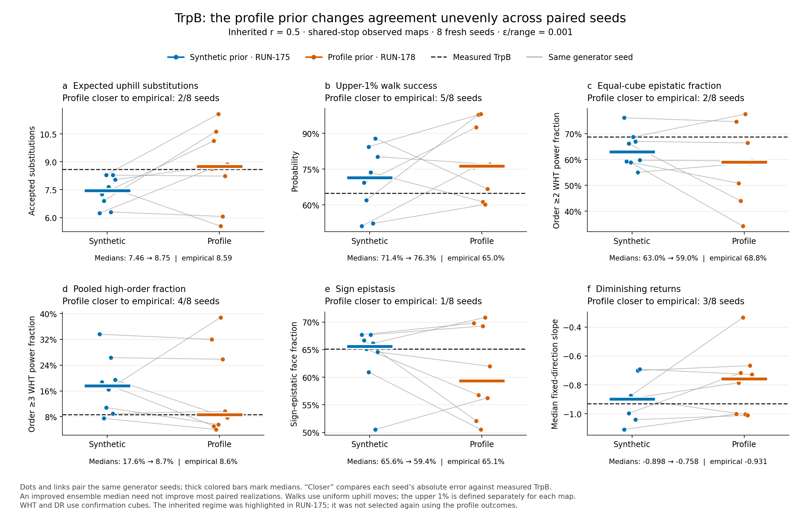
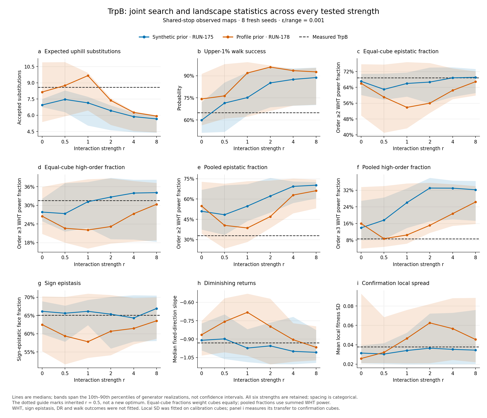
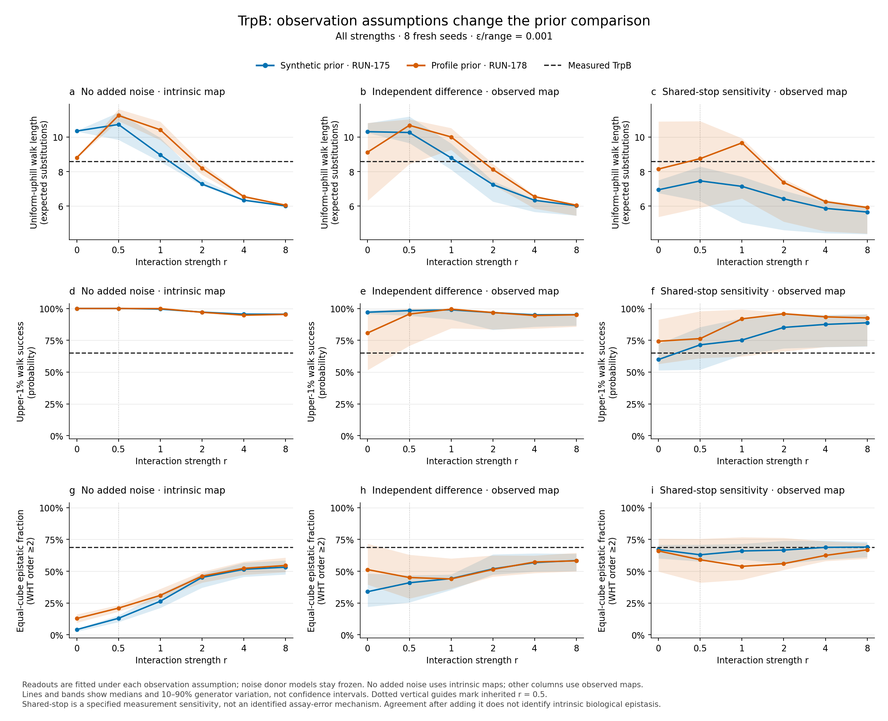
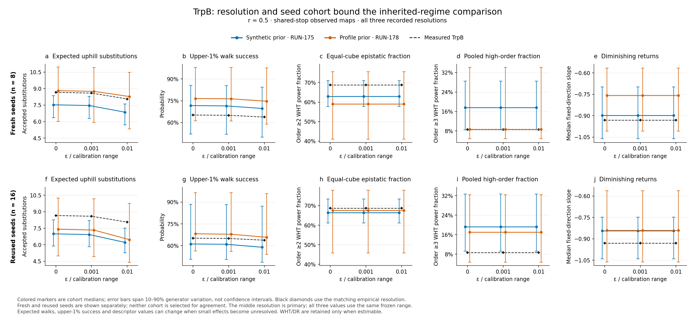
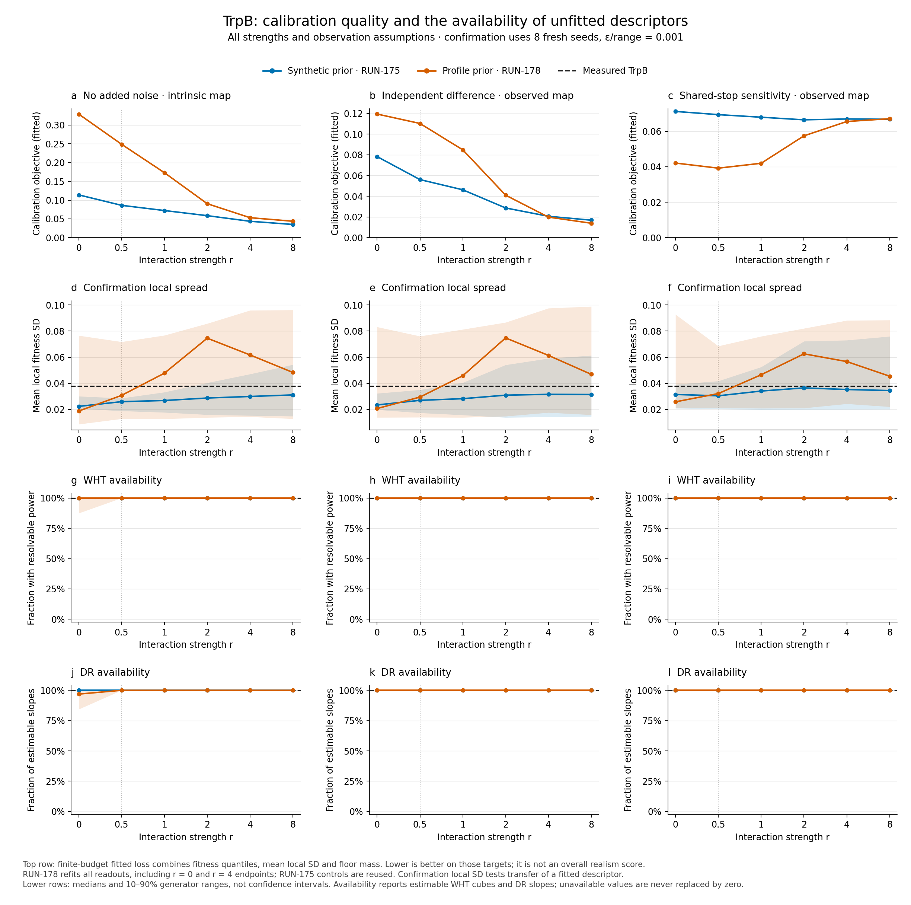

# ANA-070 — TrpB: profile prior versus synthetic control

**RUN-178 completed successfully. Adding the alignment profile changes the calibrated landscapes, but does not consistently improve their agreement with measured TrpB.** Some median summaries improve; several local epistasis measures worsen, and the outcome varies substantially between generator seeds.

This is the requested comparison under **EXP-065**: RUN-178 supplies the profile prior and the existing RUN-175 supplies the fully synthetic control. The control was not rerun. [The executed figure notebook](notebooks/analysis.ipynb) regenerates all five figures and comparison tables; [the executed validation notebook](notebooks/validation.ipynb) independently checks provenance and numerical calculations.

## What changed, and what stayed matched

The profile supplies amino-acid preferences at TrpB sites 183, 184, 227 and 228, replacing random additive effects. Interactions remain synthetic. The same calibration procedure then refits the global fitness readout, including the original endpoint fits. Thus this tests **the additive prior followed by the same calibration procedure**, rather than changing the prior while keeping fitted parameters fixed.

The six interaction strengths, three observation models, fitting budget, seed identities, empirical mask, cube geometries and observation assignments are matched. Both versions use 32 calibration cubes and 32 disjoint confirmation cubes from the same empirical landscape, and eight synthetic cubes per seed. The main figures show eight generator seeds withheld from calibration; the other 16 evaluation seeds appear separately. These are computational seeds, not independent biological replicates or a new empirical dataset. Whole-library graph metrics include calibration nodes: they are unfitted descriptors, not a disjoint genotype test.

Blue denotes the synthetic prior, orange the profile prior, and black measured TrpB. Bands are the 10th–90th percentiles across seeds, **not confidence intervals**. The inherited reference setting is **r = 0.5, shared-stop observation sensitivity, resolution = 0.001 × the empirical calibration range**. It was highlighted in the earlier control analysis, not selected to favor RUN-178.

## 1. Better medians do not mean consistently better landscapes

**Figure 1.** Each thin line connects the same generator seed across priors. Thick marks show medians. The black reference is the empirical value; neither higher nor lower is intrinsically better. “Closer” counts seeds whose absolute error decreases with the profile. A tolerance of 1e-10 distinguishes numerical ties only.

The profile brings median walk length close to the measured value, **7.46 → 8.75 steps versus 8.59**, but only **2 of 8** paired seeds improve. Median pooled high-order power fraction also becomes close, **0.176 → 0.087 versus 0.086**, with **4 of 8** seeds improving. These favorable medians therefore do not describe uniform seed-level improvement.

| Descriptor | Measured TrpB | Synthetic median | Profile median | Paired seeds closer with profile |
|---|---:|---:|---:|---:|
| Uphill walk length | 8.589 | 7.459 | 8.749 | 2/8 |
| Probability of reaching top 1% | 0.650 | 0.714 | 0.763 | 5/8 |
| Equal-cube epistatic power fraction | 0.688 | 0.630 | 0.590 | 2/8 |
| Equal-cube high-order power fraction | 0.316 | 0.273 | 0.226 | 4/8 |
| Pooled epistatic power fraction | 0.330 | 0.484 | 0.405 | 5/8 |
| Pooled high-order power fraction | 0.086 | 0.176 | 0.087 | 4/8 |
| Sign epistasis | 0.651 | 0.656 | 0.594 | 1/8 |
| Median diminishing-returns slope | −0.931 | −0.898 | −0.758 | 3/8 |
| Confirmation local fitness SD | 0.0379 | 0.0304 | 0.0322 | 3/8 |

Medians and paired error counts answer different questions: the median of a collection can approach the target even if most individual seeds move away. [The numerical table](tables/inherited_regime_comparison.csv) also reports seed spread, both cohorts and available denominators.

Walks start uniformly over measured genotypes and choose uniformly among improving neighbors. Length and success are exact graph expectations, not sampled trajectories. “Top 1%” is defined within each landscape; it does not test recovery of the same empirical genotype.

## 2. The interaction sweep retains competing effects

**Figure 2.** All six strengths are retained, with medians and seed variation for both priors. At higher strengths, profile landscapes recover more equal-cube epistasis and stronger diminishing returns, while walks become shorter and top-1% success remains above the empirical value. No tested strength improves every displayed descriptor over the control.

Equal-cube summaries give each resolvable local cube equal weight. Pooled summaries weight cubes by their nonconstant fitness variation. This explains why an improvement in pooled power can coexist with worse agreement for the typical local cube. Each power fraction divides the specified interaction-order power by total nonconstant power. Epistatic fractions include orders two through four; high-order fractions include orders three and four. Sign epistasis means that the sign of a mutation effect changes with background. A negative diminishing-returns slope means a mutation tends to have a smaller effect on fitter backgrounds. These graph and epistasis descriptors were not fitted.

## 3. The observation assumption remains consequential

**Figure 3.** Each column uses a readout calibrated under its stated observation assumption; the noise donor model remains frozen. The first uses intrinsic fitness without added noise; the others use observed maps with draws frozen once per genotype. These are not three noise overlays on one common fitted landscape.

Without added noise, the profile's median top-1% success is approximately **95–100%** across the sweep, compared with **65%** empirically. Shared-stop observations yield closer illustrative regimes, but shared-stop error remains a sensitivity assumption, not an identified measurement mechanism. Even at **r = 0**, profile plus shared-stop observations gives an equal-cube epistatic fraction of **0.660**, versus **0.688** measured. Nonlinearity and observation effects can therefore generate substantial apparent epistasis without a latent interaction field.

## 4. Seed cohort and resolution affect the comparison

**Figure 4.** The inherited r = 0.5/shared-stop setting is shown for both seed cohorts at all three resolutions. Empirical references use the matching resolution. A zero threshold counts any strictly improving step; positive thresholds disregard sufficiently small changes.

At the primary resolution, the profile's walk-length median is **8.75** on fresh seeds and **7.33** on reused seeds. Keeping these cohorts separate prevents a pooled summary from concealing that difference. All strengths, intrinsic maps from noisy calibrations, greedy walks, exact-best outcomes and neutral-component measurements remain available in the [per-seed results](tables/per_seed_results.csv.gz).

## 5. Lower fitted loss is not proof of better unfitted behavior

**Figure 5.** The first row shows the fitted objective. Other rows show local fitness SD on confirmation cubes and the availability of epistasis and mutation-slope diagnostics. Missing quantities remain missing rather than being replaced by zero.

At r = 0.5/shared-stop, loss falls **0.0694 → 0.0392**, primarily through the fitness-quantile term. The fitted mean-SD term worsens slightly. The no-noise loss is worse with the profile at every tested strength. The objective fitted fitness quantiles, mean local SD and near-floor mass, so a lower loss does not establish improved walks or epistasis. Confirmation SD tests transfer of a fitted descriptor to different cubes.

Every differential-evolution search reached its original 60-iteration limit. These are reproducible finite-budget fits, not established global optima. [Selected parameters and objective components](tables/selected_parameters.csv) and [independent fit checks](tables/fit_audit.csv) preserve the full comparison.

## What this establishes

The model now carries explicit alignment-derived amino-acid preferences, and the matched experiment shows their consequences after calibration. **It does not establish that the profile prior is generally more realistic than the synthetic prior.** Nor does it establish that biological profiles are unhelpful: this experiment measures selected landscape summaries, not whether alignment-aware models or pLMs learn better in the environment.

Interpretation remains specific to four TrpB sites and the examined observation models. The prior uses the original authors' complete frequency table rounded to 0.001 because the archived raw alignment is unusable. Non-gap conditioning and a fixed 1% uniform probability mixture precede log-frequency conversion. Sequence weighting and effective sample size are unknown. This is a biological preference prior, not an inferred free-energy map or a coevolutionary interaction model. Seed-specific reference sequences remain computational centering anchors, not the biological wild type or consensus; preserving them keeps the comparison matched.

The empirical landscape has already informed model development. Fresh generator seeds do not make it a new biological validation set. This analysis does not test active-learning performance, sequence-specific prediction, other proteins or arbitrary-length empirical fidelity. It applies no new scientific pass gate and creates no new RES or CLAIM; the existing synthetic-prior CLAIM-004 retains its original scope.

## Reproducibility and record

RUN-178 finished locally with exit code 0 in **416.51 seconds**, covering 18 calibration settings and 24 evaluation seeds. Its source, inputs, environment, logs and outputs are preserved in its DVC bundle. RUN-175 ran on Linux/Zig; RUN-178 used macOS/Apple Clang with matching Python 3.11.15 and numerical package versions. The platform change is recorded, not claimed to be bit-for-bit equivalent.

The [validation notebook](notebooks/validation.ipynb) verified 238 archived output hashes across both runs, source/input identities, all 36 selected objectives and 42 fit traces. An independent Hadamard calculation reproduced 4,326 TrpB WHT summary rows to within 1.42e-12. All empirical graph/cube rows and paired cube geometries match exactly; all 24 complete interaction fields agree within 4.45e-15. These checks establish computational consistency, not empirical adequacy. Whole-graph dynamic programming and optimization were not rerun in this analysis.

See [README](README.md) for reproduction commands, [audit.json](tables/audit.json) for verification details, and [the table manifest](tables/table_manifest.json) for source identities and aggregation rules. Each figure is also available as a vector PDF beside its PNG. Analysis artifacts are archived in `data/processed/aggregate-thermodynamic-gnk-calibration/ANA-070.dvc`; local cache verification is recorded in `storage_verification.json`. Remote backup remains pending while Dutch is unavailable.
