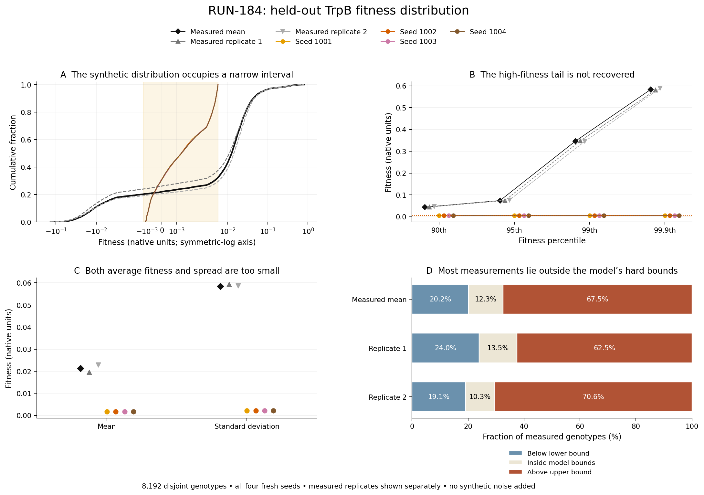
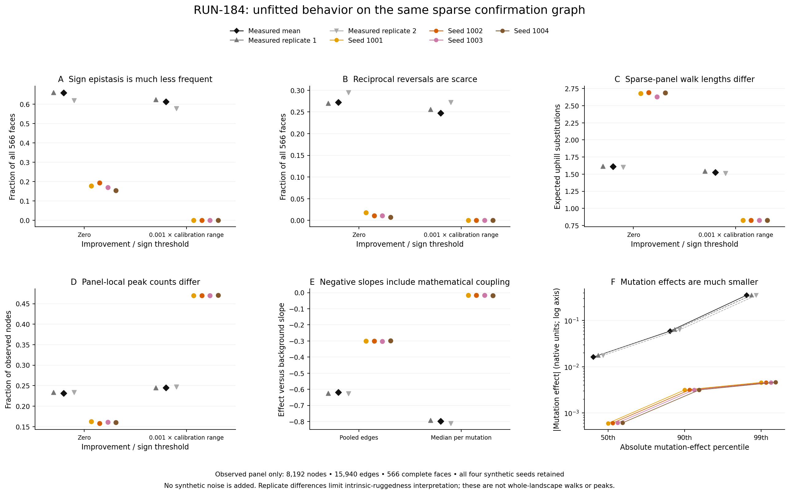
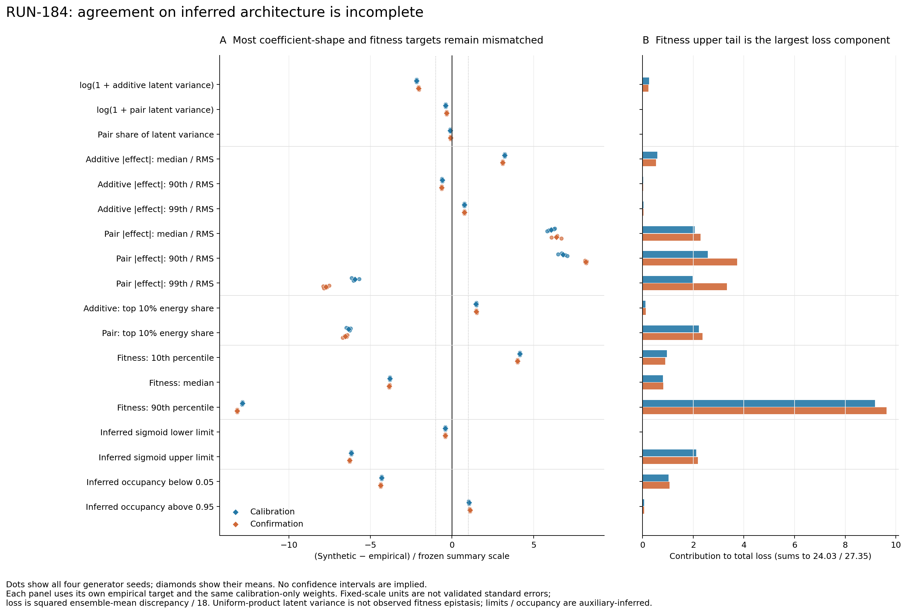
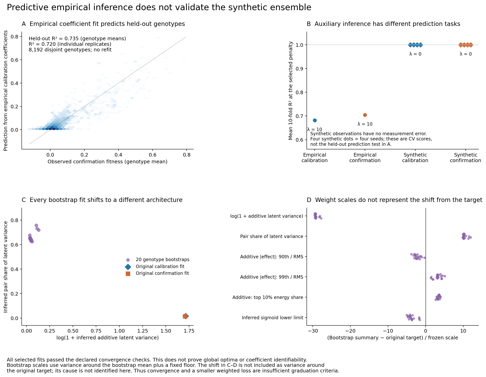
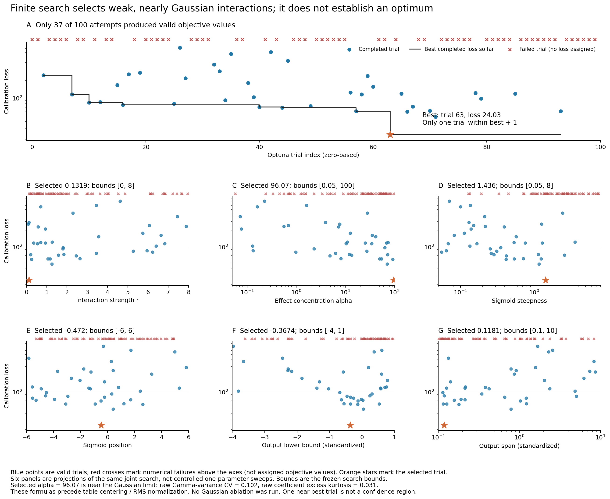

# ANA-071 — Does the RUN-184 model reproduce TrpB?

**No: the selected calibration is not ready to graduate as a TrpB-calibrated online environment.** Its fitness distribution is much too narrow, it produces too little sign epistasis, and its uphill-search behavior differs on the measured confirmation graph. Some inferred architecture summaries are closer, but those agreements do not recover the observed landscape. This concerns the achieved RUN-184 fit, not proof that the model family cannot reproduce TrpB.

The run completed reproducibly. Numerical completion and biological adequacy are separate findings. The [landscape notebook](notebooks/analysis.ipynb) produces Figures 1–2; the [architecture notebook](notebooks/architecture.ipynb) produces Figures 3–5. The [validation notebook](notebooks/validation.ipynb) checks inputs, objective calculations, convergence and prediction replay. Each PNG has a matching vector PDF.

## What was tested

RUN-184 calibrates a generator comprising a profile-conditioned additive field, six full 20 × 20 pair tables and a sigmoid. Pair coefficients use Gamma-normal variance mixing. Optuna searches interaction strength **r**, effect concentration **alpha**, sigmoid steepness and position, plus lower bound and output span. It matches 18 summaries from the same auxiliary additive-plus-pairwise sigmoid inference applied to empirical and simulated observations. It does **not** fit the empirical identity of each mutation or interaction.

Calibration and confirmation each contain **8,192 disjoint genotypes**, with two actual assay replicates per genotype. Four fresh generator seeds (1001–1004) supply confirmation. These genotypes were withheld from this fit, but TrpB previously informed project development; this is not a new biological validation dataset. All seeds are shown. Their ranges describe four realizations, not confidence intervals or biological replicates.

The primary run adds **no measurement noise** to simulated values. The fitted fitness quantiles use individual observations; graph diagnostics use genotype means. Both empirical replicates and their means are retained. This analysis changes no parameters or fitting settings.

## 1. The model misses the fitness distribution and high-fitness tail

**Figure 1.** Comparisons use native assay units and retain the high-fitness tail. The model's two stored replicates are identical noiseless values. Measured replicates and their means distinguish assay variation from persistent between-genotype variation.

| Confirmation quantity | Measured TrpB | Four model seeds |
|---|---:|---:|
| Fitness SD, genotype means | 0.05842 | 0.002183–0.002188 |
| Median fitness, genotype means | 0.01257 | approximately 0.00131 |
| 90th percentile, individual observations | 0.04541 | approximately 0.00508 |
| 99th percentile, genotype means | 0.34618 | approximately 0.00570 |

The model's SD is approximately **27 times smaller**. Its attainable output interval is only **−0.001234 to 0.005753**; **87.72% of measured genotype means lie outside that interval**. The missing high-fitness tail matters for an environment intended to study discovery of improved variants. The 99th percentile is an additional diagnostic beyond the fitted 10th, 50th and 90th percentiles.

Noise does not explain this compression: empirical replicate correlation is **0.9599**, and averaging replicates changes SD only from **0.05904 to 0.05842**. Noise can still affect local mutation signs: 23.16% of observed edge signs disagree between the two replicates. The distributional mismatch nevertheless persists after averaging, and both replicates retain the large sign-epistasis mismatch.

## 2. Unfitted local epistasis and navigation also differ

**Figure 2.** Every landscape uses the same confirmation genotypes, observed edges and complete two-site faces. Per-replicate empirical values and finite-resolution sensitivity are distinguished from the primary genotype-mean, zero-threshold calculation. Missing genotypes are never filled in.

| Unfitted descriptor, zero threshold | Measured genotype means | Four model seeds |
|---|---:|---:|
| Faces with any sign epistasis | 65.90% | 15.37–19.43% |
| Faces with reciprocal sign epistasis | 27.21% | 0.71–1.77% |
| Expected uniform-uphill steps | 1.611 | 2.629–2.694 |
| Fraction of panel-local peaks | 23.16% | 15.83–16.25% |
| Pooled fixed-orientation mutation slope | −0.619 | −0.302 to −0.299 |

Sign epistasis means that a mutation changes from beneficial to deleterious across a face; reciprocal sign epistasis means both mutations reverse sign. The model underproduces both. Walks choose uniformly among improving observed neighbors and stop when none remains. Their expected length is calculated by dynamic programming. Longer walks here do not establish better discovery of high-fitness targets.

These are **sparse-panel descriptors**, not whole-landscape measurements: 8,192 nodes, 15,940 edges and 566 faces give mean degree **3.89**, versus 76 on the complete four-site q20 graph. A panel-local peak may have unobserved improving neighbors. These walk lengths cannot be compared directly with earlier whole-library values around 8–11 steps.

The pooled mutation slope uses a fixed alphabet orientation and shares starting fitness with the effect calculation. Its negative sign alone does not establish a biological diminishing-returns mechanism. Mutation-specific slopes are retained separately. The positive resolution threshold is fixed at 0.001 times the calibration genotype-mean fitness range; it is a sensitivity calculation, not an acceptance criterion.

## 3. A few closer architecture summaries do not recover the landscape

**Figure 3.** Calibration and confirmation are separated. Residuals use the run's fixed bootstrap-plus-floor scales, not statistical z-scores. Loss averages squared scaled discrepancies in 18 summaries; it is not a likelihood, prediction R² or calibrated adequacy score.

Confirmation additive latent variance is relatively close: approximately **3.91 versus 4.52** empirically. Pairwise variance share is **0.86% versus 1.44%**—a 0.58 percentage-point gap, but roughly 40% underestimation. Several additive coefficient-shape summaries are also closer than the pairwise summaries.

The model misses **concentration of pairwise effects**. The strongest 10% of inferred pair coefficients carry **94.02%** of empirical squared coefficient mass, versus **42.70–44.80%** for the model. The empirical 99th percentile of absolute pair coefficients divided by their RMS is **5.25**, versus **2.51–2.64**.

These are regularized auxiliary estimates, not directly observed biological coefficients. Top-10% energy is not Thornton's predictive-retention T90 statistic. Latent variance shares precede the sigmoid under uniform-product genotype weighting; they are not observed-fitness epistatic variance or Walsh–Hadamard power. Inferred occupancy and endpoints likewise do not directly measure biochemical saturation.

Confirmation loss **27.35**, versus calibration loss **24.03**, shows that the mismatch persists. Its square root is **5.23 fixed-scale units**. The fitness 90th-percentile mismatch contributes approximately **9.63** loss units; pairwise coefficient shape/concentration contributes approximately **11.72**. Similar calibration and confirmation losses do not imply an adequate fit.

## 4. The empirical coefficient model predicts reasonably, but its architecture is unstable

**Figure 4.** The empirical auxiliary model is distinct from the synthetic generator. Its frozen calibration coefficients are evaluated on confirmation without refitting. Bootstrap outcomes are displayed individually, not as reassuring uncertainty bands around the point estimate.

The empirical coefficient model achieves **held-out R² = 0.720** against individual observations (**0.735** against genotype means). Selected internal CV R² is 0.682 during calibration and 0.705 for the separately fitted confirmation model. This supports predictive usefulness of the additive-plus-pairwise sigmoid architecture on these data. It does not validate the generative sampling assumptions.

Calibration additive `log1p(variance)` is **1.714**, while **all 20** bootstrap estimates are **0.034–0.131**. Calibration pairwise variance share is **1.59%**, versus **62.4–75.8%** across bootstraps. All selected fits pass the numerical convergence requirements. Convergence therefore does not establish stable decomposition or a global optimum.

The cause of this shift is unresolved. Stored scales reproduce exactly, but the bootstrap spread is not dependable uncertainty around the point estimate. No target, weight or fit is changed here. Empirical selected fits use penalty 10; best synthetic fits use zero and have CV R² near one. Noiseless samples generated within the auxiliary family are an easier inference problem than measured observations, and regularization can affect their inferred coefficient distributions.

## 5. Search completion does not establish a robust calibrated regime

**Figure 5.** All 100 attempts are retained, including **63 convergence failures**. Successful trials are optimization outcomes, not posterior samples. Parameter bounds show the search domain, not biological uncertainty.

Only **37 attempts** yielded valid objectives. Trial 63 wins at 24.03; second-best is approximately 48.10. Only the winner lies in the descriptive best-loss-plus-one region. No broad or identifiable region of comparable fits is demonstrated.

The winner has **r = 0.132**, **alpha = 96.1**, steepness **1.436**, position **−0.472**, and standardized output span **0.118**, close to its lower bound of 0.1. Alpha is near the Gaussian limit: uncentered Gamma-normal excess kurtosis is `3/alpha ≈ 0.031`. Thus the selected fit makes little use of the new effect-concentration capability. Finite search and failed attempts prevent interpreting this as evidence that the capability is unhelpful.

## Graduation assessment

| Intended status | Assessment from RUN-184 |
|---|---|
| Reproducible, executable synthetic oracle | **Yes, computationally.** Frozen-source predictions replay and the workflow completed. |
| Recreation of TrpB's fitness distribution | **No.** Severe range compression and a missing high-fitness tail persist on confirmation. |
| Recreation of local epistasis and navigation | **No at this setting.** Sign reversals, panel peaks and uphill paths disagree substantially. |
| Stable, biologically interpretable inferred architecture | **Not established.** Bootstrap decompositions shift radically despite convergence. |
| Ready as a TrpB-representative environment for ML or active learning | **No on this evidence.** Usable as a declared synthetic test function, but not a validated TrpB surrogate. |

This qualitative assessment rests on the size and consistency of discrepancies; it is not a retrospectively invented formal pass gate. RUN-184 had no preregistered numerical adequacy threshold. It supplies no ML benchmark, comparative efficiency test, long-sequence validation or biological generalization.

The favorable regimes in [ANA-070](../2026-11-19_ANA-070_run-178-trpb-profile-prior-versus-synthetic-control/analysis.md) and [CLAIM-004](../../claims/CLAIM-004_thermodynamic-gnk-trpb-aggregate-and-adaptive-search-resemblance.md) use different interaction ensembles, observation assumptions, objectives and graphs. Their evidence is preserved and cannot be transferred to this changed fit or used to compare loss magnitudes. Model defaults and presets are unchanged.

## Literature and reproducibility

[Johnston et al. (2024)](https://pmc.ncbi.nlm.nih.gov/articles/PMC11317637/) supplies the four-site growth-associated TrpB assay. [Park, Metzger and Thornton (2024)](https://doi.org/10.1038/s41467-024-51895-5) anchors the inference architecture. The [implementation mapping](../../external/Adapt-Env/docs/RFA_IMPLEMENTATION.md) records solver differences; the [protocol](../../experiments/2026-10-07_EXP-065_aggregate-thermodynamic-gnk-calibration/architecture_calibration.md) declares the generative assumptions and outer objective. The published model's empirical results are not inherited by AdaptEnv.

[README](README.md) gives reproduction commands and the pinned environment. Notebooks independently reconstruct objectives, empirical summaries and sparse graph diagnostics, and replay all four native oracle predictions. They do not rerun optimization or auxiliary inference. Original parameters, failures and hashes remain intact. Analysis artifacts are archived under `data/processed/aggregate-thermodynamic-gnk-calibration/ANA-071`; storage verification is separate. No RES, CLAIM, model release or preset promotion is made.
