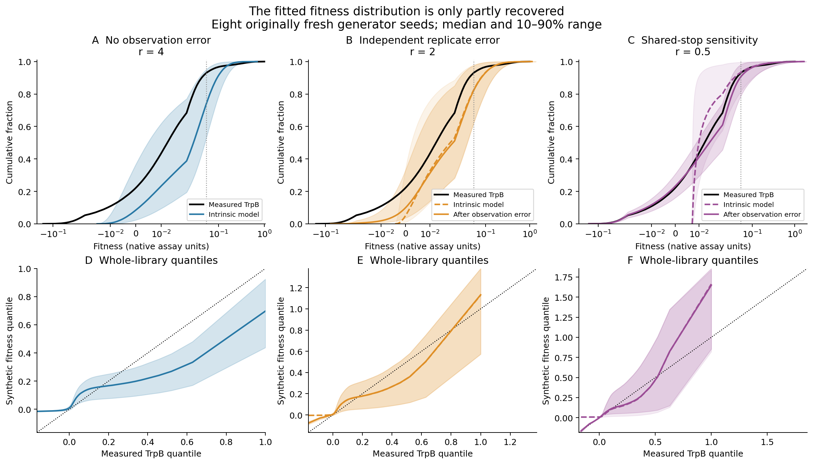
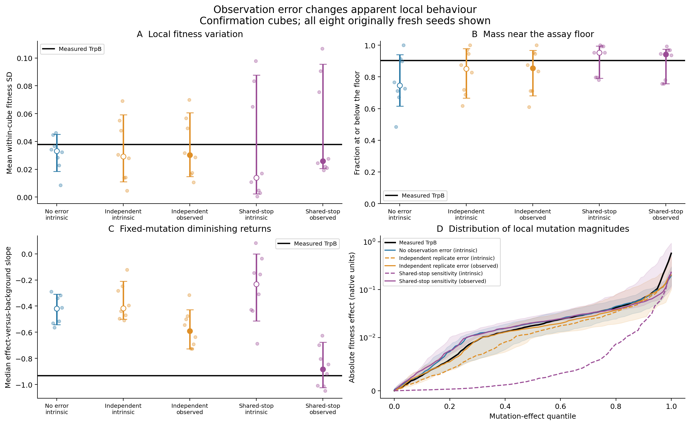
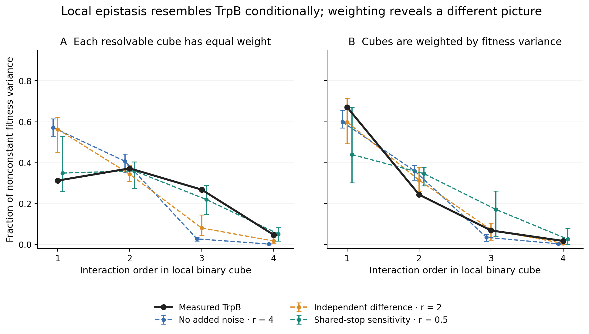
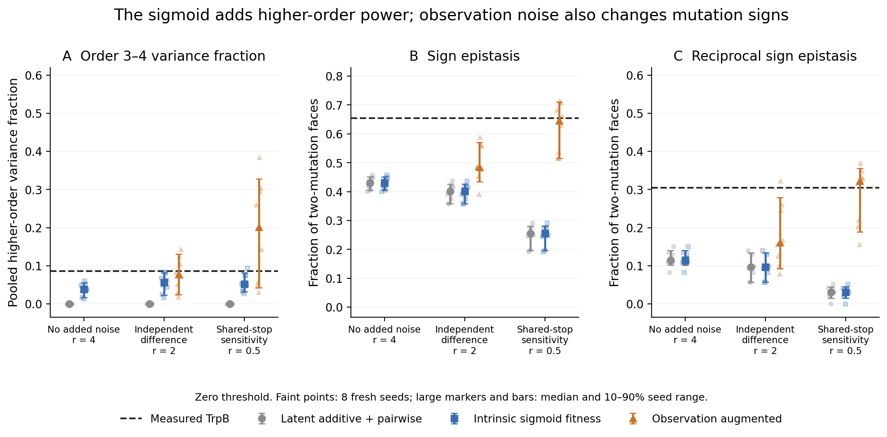
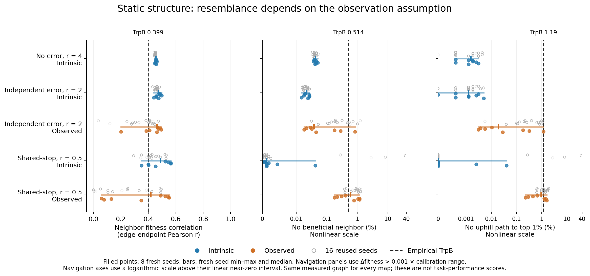
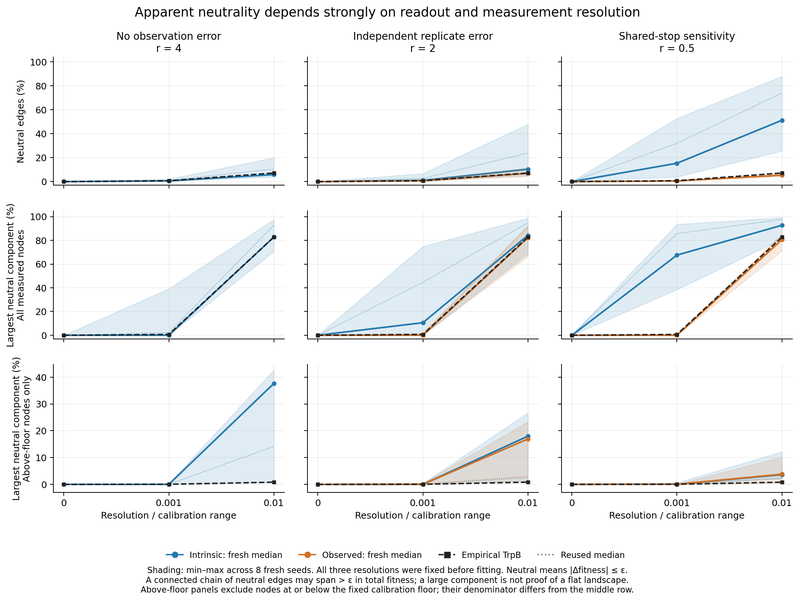
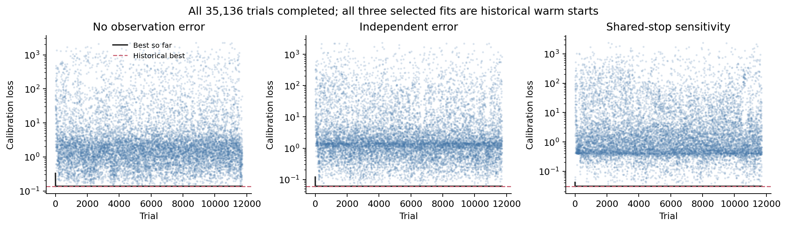

# ANA-072 — What RUN-186 reproduces about TrpB

**RUN-186 recovers part of the measured TrpB landscape, with agreement strongly dependent on the observation model.** The shared-stop sensitivity setting is close in full-library mean, standard deviation and several local trapping descriptors. It does not reproduce the upper tail, variance-weighted genetic architecture or neutral connectivity consistently. Its intrinsic, noiseless landscape is substantially smoother by several local descriptors; much of the apparent agreement appears after observation error is added.

The analysis supports a **qualified synthetic analogue of this four-site assay**, not a demonstrated match to TrpB's biological interaction coefficients or its difficulty for ML and optimisation. There is no new formal graduation gate in this analysis, and no model preset is promoted.

[Reproduction instructions](README.md) · [Average behaviour notebook](notebooks/analysis.ipynb) · [Architecture notebook](notebooks/architecture.ipynb) · [Difficulty notebook](notebooks/difficulty.ipynb) · [Validation notebook](notebooks/validation.ipynb)

## What was compared

RUN-186 jointly fitted continuous interaction strength `r ∈ [0,8]` and four sigmoid/readout coordinates using Optuna. The restored loss combines the error in 101 fitness quantiles, relative error in mean local-cube SD, and error in near-floor mass, with unit weights. The generator has profile-conditioned additive effects and six full, centred 20×20 pair tables. Pair coefficients remain Gaussian: Gamma concentration was neither enabled nor fitted.

Each observation assumption was fitted separately. Consequently, the three settings below are **not a controlled sweep of r**. “Intrinsic” means the noiseless fitness after the sigmoid; “observed” adds the recorded observation layer. The shared-stop layer is a sensitivity assumption, not an identified mechanism of TrpB measurement error.

| Observation assumption | Selected r | Calibration loss | Improvement over RUN-180 |
|---|---:|---:|---:|
| No observation error | 4 | 0.13755328 | 0 |
| Independent replicate error | 2 | 0.06074944 | 0 |
| Shared-stop sensitivity | 0.5 | 0.03099517 | 0 |

All 35,136 trials completed without failures; the selected parameters and corresponding confirmation descriptors reproduce the historical RUN-180 warm starts. These are results of a completed search budget, not evidence of convergence or a globally optimal fit. The lower calibration loss under shared-stop does not imply it wins every subsequent diagnostic.

Full-library comparisons use the same **159,129 measured genotypes and 6,016,433 undirected single-mutation edges** for empirical and synthetic maps. This includes calibration genotypes. Local comparisons use 32 empirical confirmation cubes, each containing 16 genotypes, and eight assigned cubes per synthetic seed. Those cubes were excluded from fitting but have already been examined in earlier records.

Primary numerical summaries use the eight seeds designated “fresh” in the original design; all 24 confirmation seeds remain in tables, and the 16 reused seeds are also visible in the graph figures. These are the same seeds as RUN-180, not a new untouched validation set. Figure ranges describe variation, **not confidence intervals**. Local-cube ranges mix variation in generator seed and assigned cube geometry. The figures state whether ranges are 10–90% or minimum–maximum.

## A. Average and systematic behaviour: partial recovery

**Figure 1.** The shared-stop observed distribution comes closest in mean and SD, but its quantile–quantile curve still departs from the identity line. Intrinsic curves are dashed where an observation layer exists. The full measured mask is used; shaded regions are 10–90% ranges across the eight originally fresh seeds. The upper panels use a symmetric logarithmic fitness axis to display negative values and the low-fitness concentration. Dotted vertical lines mark the fixed near-floor threshold.

| Full-library descriptor | Measured TrpB | Shared-stop observed, median |
|---|---:|---:|
| Mean fitness | 0.02115 | 0.02274 |
| Fitness SD | 0.05998 | 0.06132 |
| Fraction near the floor | 92.95% | 91.11% |
| 99th percentile | 0.3500 | 0.2442 |
| Maximum | 1.000 | 1.649 |

Thus similar first two moments coexist with an underrepresented 99th percentile and an overextended extreme tail in these separately computed median summaries. Individual seeds vary substantially; the close median mean and SD should not be read as uniform agreement across realizations. Near-floor means fitness ≤0.05383169 in native assay units, a fixed calibration-derived threshold rather than clipping or literal inactivity.

**Figure 2.** Observation error changes local variation, mutation magnitudes and apparent diminishing returns. Each point is one of the eight originally fresh seeds; bars and shading show medians and 10–90% ranges. Empirical black lines use the confirmation cubes, so their floor mass differs from the full-library value in Figure 1.

The shared-stop observed median within-cube SD is **0.0260 versus 0.0379** in TrpB. Its intrinsic value is only **0.0140**. The median fixed-mutation effect-versus-background slope is **−0.882 versus −0.931** empirically, but is only **−0.233** intrinsically. This slope is a descriptive OLS statistic, not evidence for a particular biological mechanism of diminishing returns; observation error can itself strengthen the negative association.

The fitted model therefore captures some average features of the measured assay, but the agreement is incomplete and partly attributable to the observation layer. Exact values and all-seed comparisons are in [distribution summaries](tables/average_distribution_summary.csv) and [local summaries](tables/average_local_summary.csv).

## B. Genetic architecture: observable structure is only partly matched

**Figure 3.** Walsh–Hadamard decompositions of the confirmation cubes divide local fitness variance into orders one through four. Equal-cube weighting asks what fraction of a typical resolvable cube is epistatic. Pooled weighting asks where the total variance across cubes resides, giving variable cubes more influence. These are different scientific summaries, not interchangeable estimates.

The distinction matters for the shared-stop observed setting:

| Local architecture descriptor | Measured TrpB | Shared-stop observed, median |
|---|---:|---:|
| Epistatic fraction, equal-cube weighting | 0.688 | 0.651 |
| Order ≥3 fraction, equal-cube weighting | 0.316 | 0.274 |
| Epistatic fraction, pooled variance | 0.330 | 0.561 |
| Order ≥3 fraction, pooled variance | 0.086 | 0.202 |
| Sign-epistatic faces at primary resolution | 0.651 | 0.641 |
| Reciprocal-sign-epistatic faces at primary resolution | 0.296 | 0.315 |

Equal-cube fractions and sign descriptors look similar, while pooled higher-order variance is about **2.3 times** the empirical value. Agreement in one weighting does not establish recovery of the genetic architecture. These fractions describe local binary restrictions of a 20-allele landscape; they are not a full-library, reference-free decomposition or an identification of TrpB's causal coefficients.

**Figure 4.** The latent field contains additive and pairwise terms only. The sigmoid can create observed higher-order variance; the observation layer can add further apparent interactions. This figure uses **zero threshold** for mutation signs to compare latent and intrinsic layers without mixing units. The preceding table instead uses the primary nonzero fitness resolution.

Independent reconstruction confirms that latent order ≥3 power is numerical roundoff (maximum fraction 3.45×10⁻³²). Zero-threshold sign and reciprocal-sign classifications are identical before and after the monotone sigmoid across all 72 seed/setting pairs. At finite resolution, compression by the sigmoid can make changes effectively neutral; observation error can also change their ordering. These mechanisms must be separated when interpreting “ruggedness.”

What is known specifically about the generated architecture is its profile-derived additive field, sampled full pair tables, interaction scale and monotone readout. **RUN-186 did not infer empirical site or pair coefficients using the Thornton method.** Park, Metzger and Thornton jointly infer genetic effects and global nonlinearity; sharing that broad architecture does not make this summary-statistic calibration an equivalent coefficient inference. [Park et al., 2024](https://pmc.ncbi.nlm.nih.gov/articles/PMC11390738/)

The [architecture notebook](notebooks/architecture.ipynb) independently reproduces all archived cube summaries and documents the transform, normalization, sign definitions and numerical checks. [All cohort summaries](tables/architecture_cohort_summary.csv) retain both weightings, layers and resolutions.

## C. Learning and optimisation difficulty: structural resemblance, not task validation

**Figure 5.** Neighbour fitness correlation describes local smoothness relevant to generalization. The fraction with no beneficial neighbour and the fraction without an uphill path to the map's own top 1% describe aspects of local navigation. All maps use the same measured genotype graph. Filled points show eight originally fresh seeds; hollow points show the 16 reused seeds. Bars span fresh-seed minima and maxima, with a median marker. Navigation axes use a logarithmic scale away from zero to keep both small values and outliers visible.

At the primary resolution, a beneficial mutation must increase fitness by more than **0.001 × the fixed calibration scale**, or 0.000193969 native fitness units.

| Static descriptor | Measured TrpB | No-error intrinsic, median | Shared-stop intrinsic, median | Shared-stop observed, median |
|---|---:|---:|---:|---:|
| Genotypes with no beneficial neighbour | 0.514% | 0.0424% | 0.00126% | 0.595% |
| Genotypes without an uphill path to their map's top 1% | 1.190% | 0.00157% | 0% | 0.958% |

The shared-stop observed neighbour correlation is **0.419 versus 0.399** empirically, but spans **0.059–0.551** across the eight seeds. Its fresh-seed median trapping descriptors resemble TrpB, whereas the intrinsic median descriptors indicate fewer local barriers to one-step ascent. This is not a universal ordering of task difficulty: some seeds are outliers, and reachability says that a path exists, not that a finite-budget algorithm will find it. “No beneficial neighbour” includes resolution-induced traps rather than only strict local maxima. Targets are defined separately within each map, not by a common absolute fitness threshold.

**Figure 6.** Neutral edges satisfy |Δfitness|≤ε. Connectivity is evaluated at the three pre-existing resolutions, with fresh-seed minimum–maximum shading and reused-seed median dotted lines. The bottom row uses only above-floor nodes, with an above-floor denominator; the middle row uses all measured nodes. A chain of individually neutral edges can span a large total fitness difference, so a connected component is not necessarily flat.

The similar trapping statistics conceal substantial connectivity differences. At the primary resolution, the largest neutral component contains **0.679% of empirical nodes versus 0.0185%** for the shared-stop observed median. Before observation error, the shared-stop median is **67.6%**. At resolution 0.01, the largest above-floor component contains **0.820% of empirical above-floor nodes versus 3.80%** for shared-stop observed. Noise and resolution therefore alter the apparent structure in ways that a single ruggedness score misses.

These are useful descriptors of possible learning and navigation challenges, but none measures learning sample complexity or optimisation performance. Fourier sparsity can yield learning guarantees under specified sampling, noise and recovery assumptions; a local four-site spectrum or neighbour correlation alone does not establish those conditions. [Brookes et al., 2022](https://pmc.ncbi.nlm.nih.gov/articles/PMC8740588/)

No learners, active-learning loops or optimisation tasks were run for this ANA. The notebooks reuse archived exact graph connectivity/reachability and compute static moments; historical walk-performance columns are not used as evidence of task performance. Observation error is frozen by genotype here, rather than redrawn on each oracle query. The figures therefore describe fixed observed maps, not a repeated-measurement noise model for an online learning task. [Graph summaries](tables/difficulty_graph_summary.csv) and [edge summaries](tables/difficulty_edge_summary.csv) retain the full comparisons.

## What this evidence supports

| Question | Assessment |
|---|---|
| Does it reproduce average TrpB behaviour? | Partly. Shared-stop gives close median mean/SD and some local trends; tail and local-variation mismatches remain. |
| Does it reproduce specific genetic architecture? | Some local observable summaries, conditionally. Pooled variance disagrees; biological coefficients were not inferred. |
| Does it recreate learning/optimisation challengingness? | Some structural proxies resemble TrpB after observation error. Actual task difficulty remains unmeasured. |
| Does RUN-186 change the earlier fitted settings? | No. All three selected fits remain RUN-180 warm starts. |
| Is broad graduation established? | No. This is a characterized, conditional four-site analogue; this analysis does not validate broad biological or ML-task equivalence. |

The differences above qualify the achieved settings; they do not show that the model family is incapable of a closer fit. There is no new independent biological system, pristine test panel, formal equivalence test, or preregistered numerical adequacy gate here. Previous release claims for other model versions are not automatically extended to this full-pairwise generator.

## Reproducibility and search audit

**Figure 7, supplementary.** Each study completed 11,712 trials. Continuous-r proposals were used; no new proposal beat the corresponding historical warm start. This figure documents the search outcome rather than a claim of optimiser superiority or convergence.

Four notebooks executed successfully in fresh Python 3.11 kernels. They authenticate the archived run and frozen runtime, independently replay the calibration loss, regenerate all 24 latent fields, reconstruct recorded observed maps, reproduce local architecture, and check graph-moment formulas against small brute-force fixtures. The audit includes 93 collected remote files, 86 output-manifest entries, 339 frozen payloads, and all 35,136 SQLite/CSV trial records. Reconstructed cube fitness agrees to 2.22×10⁻¹⁶; frozen latent pair fields agree within the previously declared cross-platform tolerance. Scientific and runner exit codes are zero.

The immutable RUN-186 input archive is DVC tracked, with directory hash `172955844a459e413b582b35328a2085.dir`. The ANA has its own archive. [README](README.md) gives exact reproduction commands; [validation checks](tables/validation_checks.json), [artifact checks](tables/artifact_validation.json), and [storage verification](storage_verification.json) retain the audit trail. No fitting, model-default changes, new result or claim records are part of this ANA.
