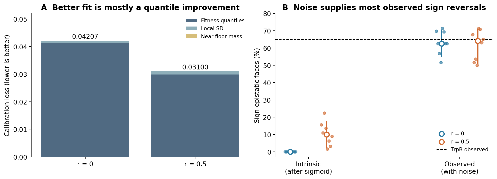
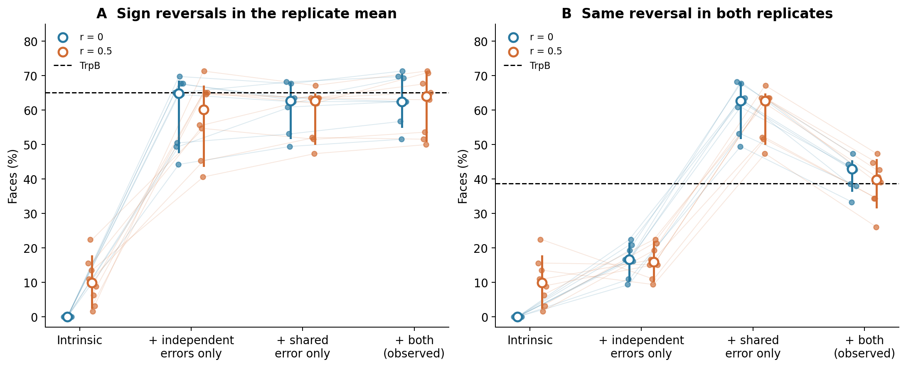
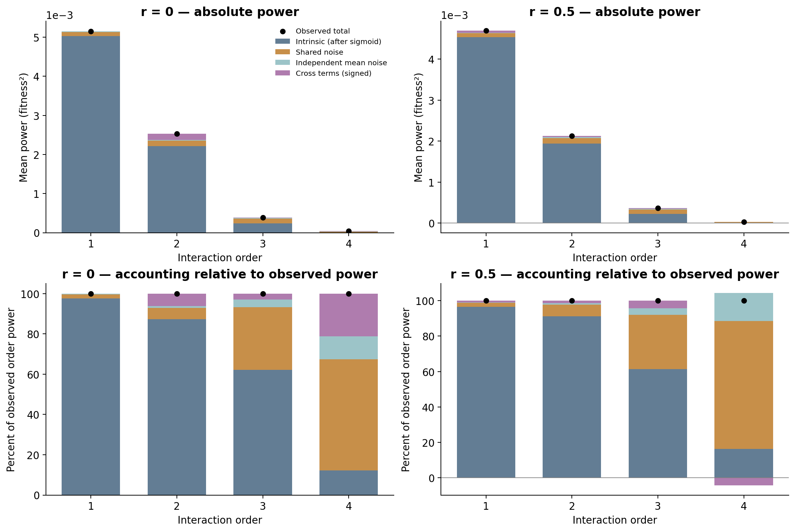
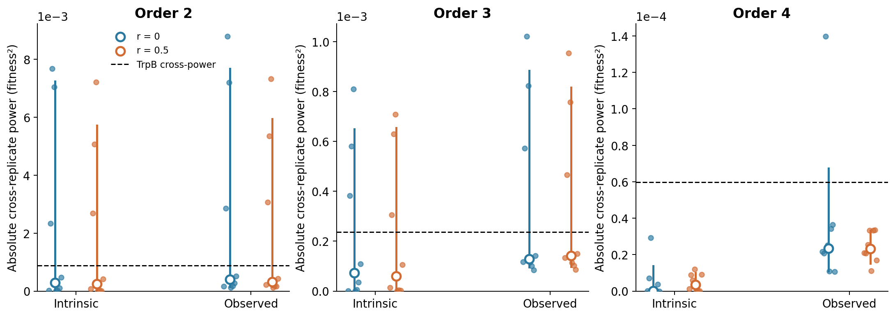
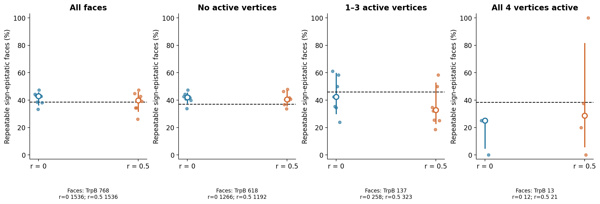
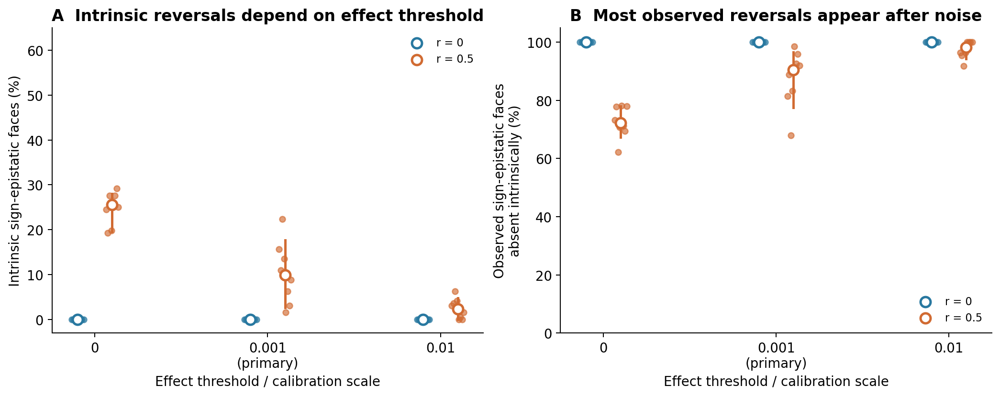

# ANA-073 — What supplies the model’s apparent epistasis?

**EXP-065 · RUN-188 · TrpB · 25 November 2026**

**The observation noise supplies most of the observed sign reversals, even when the latent pairwise interaction strength is zero.** The full model fits the calibration summaries better, but its apparent resemblance to TrpB in sign epistasis largely survives removing latent pairwise interactions and refitting the readout. This is evidence that the observation layer can supply ruggedness independently of r. It is **not** evidence that real TrpB epistasis is mostly measurement noise.

The distinction matters: **noise dominates the sign-reversal pattern, but not all epistatic power**. Large intrinsic fitness contrasts still supply most pooled order-2 power; noise has a larger relative role at higher orders and among small effects.

[Executed notebook](notebooks/analysis.ipynb) · [Reviewable Python source](notebooks/analysis.py) · [Reproduction instructions](README.md) · [RUN protocol](../../experiments/2026-10-07_EXP-065_aggregate-thermodynamic-gnk-calibration/interaction_ablation.md)

## The matched comparison

RUN-188 independently refitted two models: profile additive + sigmoid with **r=0**, and profile additive + full pairwise terms + sigmoid with **r free in [0,8]**, selecting **r=0.5**. Both used the frozen RUN-186 shared-stop observation law, paired generator fields and noise uniforms, the same calibration loss and bounds, and 11,712 Optuna trials each. Neither improved its historical queued candidate. The selected full model is exactly the shared-stop setting analysed in ANA-072.

The four readout parameters were refitted in each arm. This is a comparison of the achieved fitted model families, not an isolated intervention on r with everything else fixed. Equal budgets do not establish global optima. Noise strength was not fitted; changing predicted fitness can nevertheless change the conditional error/depth bin. “Unstructured” refers to sampled genotype-level residuals without the model’s latent pairwise organisation; the noise law itself is conditioned on fitness and depth.

The main figures use eight originally fresh seeds, each with eight assigned confirmation cubes, and 32 empirical confirmation cubes. All 24 synthetic seeds and all three resolutions are retained in the tables. These panels have already been inspected. Points and 10–90% ranges show generation and assigned-panel variation, not confidence intervals or biological replication. Unless stated otherwise, sign reversals require effects larger than **0.001 × the fixed calibration scale** (0.00019397 in native fitness units).

## 1. A better calibration loss does not establish a better explanation of epistasis

The full model’s loss is **0.030995**, versus **0.042075** at r=0: a **26.3% reduction**, mostly in the fitness-quantile component. The local-SD component is slightly worse. Sign epistasis and interaction powers did not enter this loss.

| Sign-epistatic faces, primary resolution | r=0 | r=0.5 | TrpB |
|---|---:|---:|---:|
| Intrinsic fitness, after sigmoid | 0.0% | 9.9% | Not observed separately |
| Observed replicate mean | 62.5% | 64.1% | 65.1% |
| Same directed reversal in both replicates | 43.0% | 39.8% | 38.7% |

Synthetic entries are medians across eight seeds. Similar aggregate rates are not an equivalence test and do not mean the same genotype-specific interactions were recovered.

**Figure 1.** Left: the actual calibration objective and its components. Right: intrinsic versus observed sign epistasis. Every observed sign reversal at r=0 appears only after noise is added. For the full model, the median fraction of observed sign-epistatic faces that were not sign-epistatic intrinsically is **90.4%**. This counts faces, not variance or biological interactions; noise can also remove existing intrinsic reversals.

## 2. Shared noise makes randomness look repeatable

The notebook reconstructs the exact saved observations as

**Y₁ = F + C + e₁; Y₂ = F + C + e₂**, where F is intrinsic sigmoid-transformed fitness, C is the shared error, and e₁/e₂ are independent errors. It then removes components algebraically. There is no refitting or new noise draw in these intermediate comparisons.

Independent errors alone generate many sign reversals in the replicate mean, but only **16.7%** of r=0 faces and **15.9%** of full-model faces show the same reversal in both replicates. With the shared component also present, these rates rise to **43.0%** and **39.8%**. Thus the apparent repeatability is substantially dependent on shared randomness. Some reversals can agree by chance even under independent errors.

**Figure 2.** Each line follows the same seed through diagnostic noise layers. “Shared error only” has identical replicate values by construction, so its reversal and repeatability rates coincide; that is not an independent validation. The combined layer is the actual fitted observation model. Shared error remains in a replicate average and in cross-replicate interaction statistics.

## 3. Noise does not supply every kind of epistatic signal

For each Walsh order, the exact accounting is

**observed power = intrinsic power + shared-error power + independent-mean-error power + signed cross terms**.

The cross terms can be positive or negative, so a universal nonnegative “fraction of epistasis caused by noise” is not defined for a realized map. Intrinsic fitness here is **after the sigmoid**. Even r=0 therefore has nonzero spectral interaction power, despite having no sign reversals.

For the full model, the pooled fresh-cube accounting is:

| Walsh order | Intrinsic power / observed power | Shared error | Independent mean error | Cross terms |
|---|---:|---:|---:|---:|
| 2 | 91.1% | 6.6% | 0.9% | 1.4% |
| 3 | 61.3% | 30.6% | 3.8% | 4.3% |
| 4 | 16.3% | 72.3% | 15.7% | −4.2% |

These are ratios of pooled absolute powers across 64 cubes, **not medians of seed fractions**. Large-amplitude seeds/cubes carry more weight. They describe an exact synthetic accounting, not causal attribution of biological variance. The r=0 model likewise retains substantial intrinsic order-2 and order-3 power from its nonlinear readout.

**Figure 3.** Upper panels show absolute powers; lower panels divide each component by observed power at the same order. Black points show the signed total. In the full model’s order-4 column, positive components exceed 100% and a negative cross term brings the total back to 100%. High-order statistical power need not imply high-order latent interaction terms; this scale distinction is consistent with [Sailer & Harms (2017)](https://doi.org/10.1534/genetics.116.195214).

## 4. The full model does not consistently improve the unfitted interaction diagnostics

Cross-replicate power removes independent zero-mean noise **in expectation**, but retains shared errors. Both models have broad seed variation and residual mismatch to the empirical absolute powers.

**Figure 4.** Absolute cross-replicate powers by order, retaining every fresh seed. The full model is closer to TrpB than r=0 in **2/8 seeds at order 2, 7/8 at order 3, and 4/8 at order 4**. For repeatable sign epistasis it is closer in **3/8 seeds**, and for repeatable reciprocal sign epistasis in **2/8**. These descriptive paired comparisons support a specific order-3 improvement, not uniform superiority. They are not significance tests, and the error of a median is not the median of paired errors.

The similarity in sign rates also coexists with mismatched pooled spectral fractions: median observed higher-order fractions are **0.160 at r=0** and **0.202 at r=0.5**, versus **0.086 in TrpB**. Looking close on one form of epistasis does not establish a matching genetic architecture.

## 5. Activity and effect resolution limit the biological interpretation

Most empirical faces have no vertices above both replicate activity thresholds: **618/768**. Among faces with one to three active vertices, repeatable sign-epistasis medians are **42.4% at r=0** and **32.7% at r=0.5**, versus **46.0% empirically**. The full model therefore does not reveal a consistent advantage away from the entirely inactive stratum.

Only **13 empirical faces** have all four vertices active; there are 12 and 21 such faces across the eight r=0 and full-model seeds. Several seeds have no members in this stratum. **No empirical or fresh-model cube has all 16 vertices active.** These sparse strata cannot establish whether structured interactions become necessary in a genuinely active region.

**Figure 5.** Observed repeatable sign epistasis, with membership counts printed below. Empty seed strata remain missing, not zero. Cube and face strata have different memberships. Activity selection uses noisy observations; between-model differences can include composition changes.

The conclusion that noise supplies most sign-epistatic faces survives changing the effect threshold. For the full model, the median proportion of observed sign-epistatic faces absent intrinsically is **72.3% at zero threshold, 90.4% at the primary threshold, and 98.3% at the coarser threshold**. The r=0 value remains 100%. The 16 reused seeds show the same broad pattern; all cohort/resolution results are exported.

**Figure 6.** Small intrinsic reversals matter when every nonzero effect counts. Applying a practical effect resolution changes the numerical noise-dependence estimate, but does not reverse the qualitative conclusion.

The stop-covariance correction is retained as a sensitivity, not a biological truth estimate. In empirical no-active cubes, the mean corrected power is negative at every nonconstant order. This repeats the interpretive problem documented in [ANA-065](../2026-10-07_ANA-065_run-168-replicate-aware-statistics-and-observation-models/analysis.md): shared assay variation and real biological variation cannot be uniquely separated using these controls. Two empirical replicates also do not isolate errors inherited from shared preprocessing.

## What this establishes

The calibrated **observed** environment contains a substantial random genotype-level contribution that can produce TrpB-like sign-epistasis rates without latent pairwise terms. The nonzero-r model still supplies genuine intrinsic sign reversals and improves the calibration fit, but this RUN does **not** establish that r is the principal control of its observed ruggedness or that the noise model is merely a harmless measurement detail.

Because these sampled errors are frozen by genotype, an online learner encounters them as stable extra structure: querying the same genotype again does not average them away. This RUN therefore concerns the geometry of a fixed observed map, not fresh measurement noise on each query.

This is a limitation of the current model interpretation, not a demonstration that TrpB’s biological landscape lacks structured epistasis. The shared-stop law remains an assumption; readouts are refitted; the achieved finite-budget fits need not be optimal; and the confirmation panels are previously exposed. No empirical interaction identities, new learning/search performance, or general biological graduation are established. Package defaults and historical claims remain unchanged.

## Reproducibility

The executed notebook generates all **six PNG/PDF figures** and numerical tables from the immutable RUN-188 archive. It verifies all **41 output payloads**, **460 frozen payloads**, **23,424 completed trials**, and **48 arm/seed observation replays**. It independently recomputes every original cube power and observed face classification, checks known-answer landscapes, and verifies the exact signed power-budget identity. Original and intermediate layer tables include all 24 seeds and all resolutions.

[Validation](tables/validation.json) · [Key numbers](tables/key_numbers.json) · [Paired contrasts](tables/paired_error_summary.csv) · [Coverage](tables/activity_coverage.csv) · [Environment](tables/analysis_environment.json)

The RUN archive and completed analysis are DVC tracked and backed up to the project’s Dutch ZFS storage. Restoration, execution and storage-verification instructions are in the [README](README.md). No new RUN, RES or CLAIM was created by this analysis.
