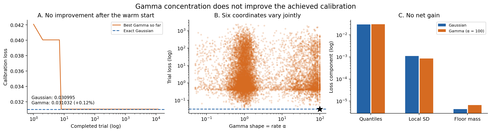
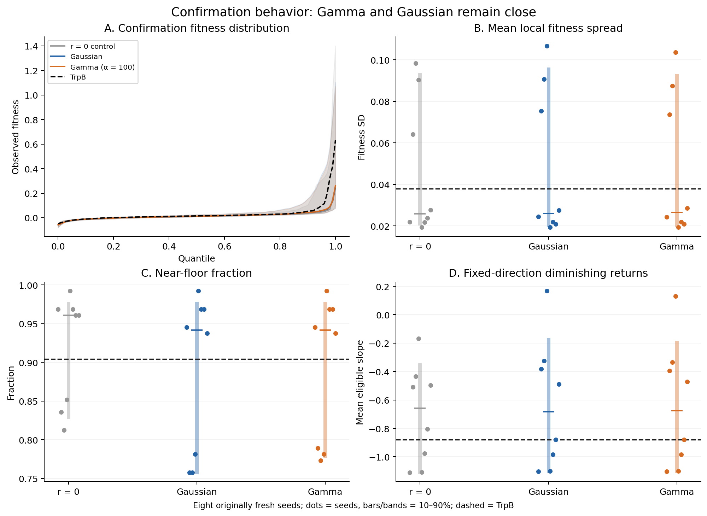
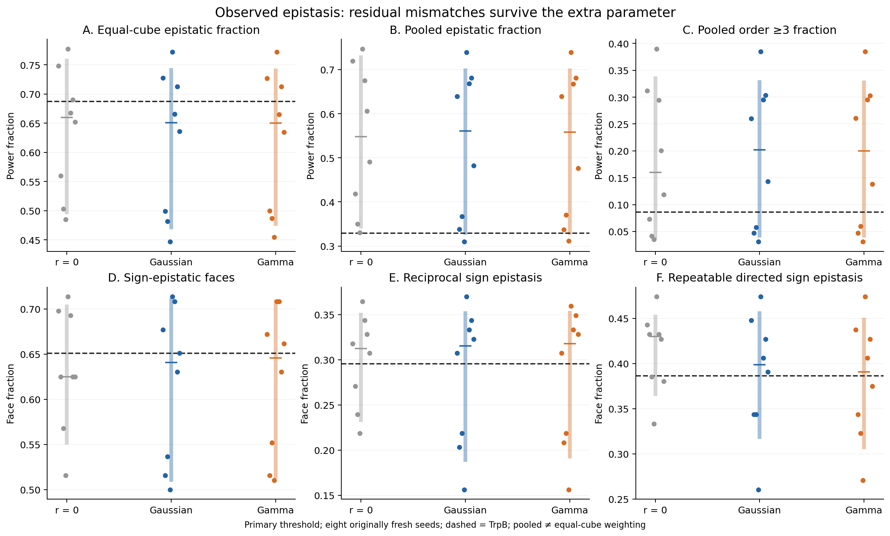
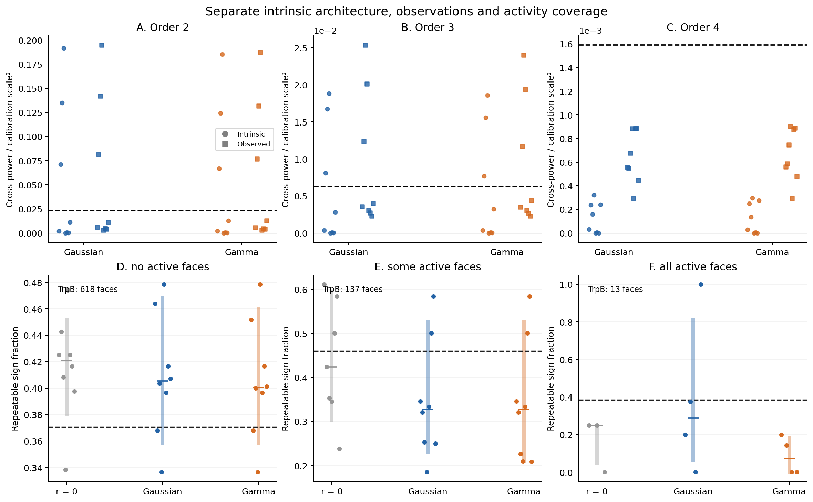
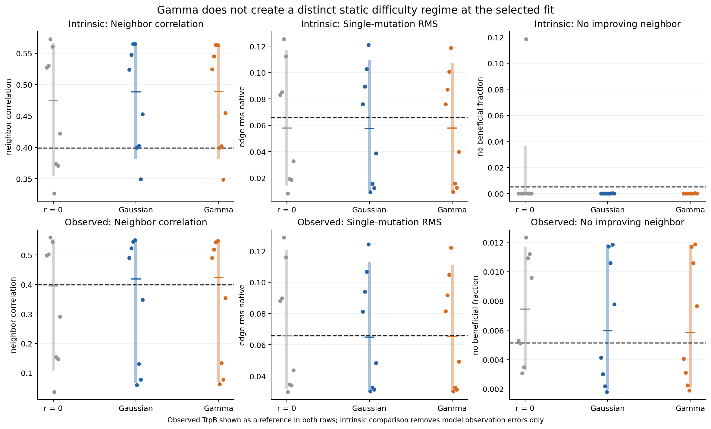
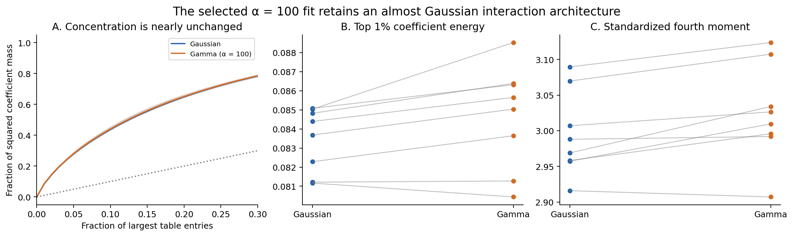
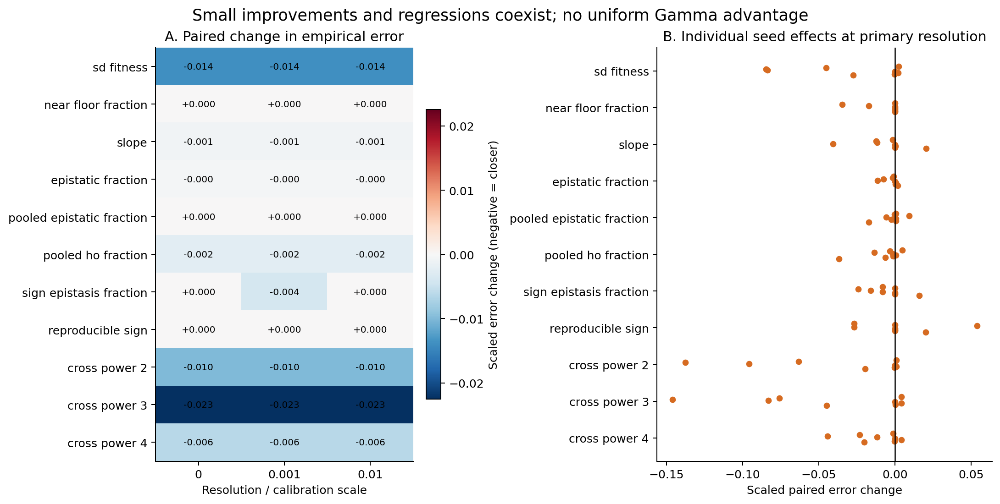

# ANA-074 — Gamma concentration does not improve the achieved TrpB calibration

**RUN-190 returns to an almost Gaussian interaction model.** The selected Gamma
shape/rate is **α = 100**, the upper search bound, with **r = 0.5** and the same
four readout parameters as the Gaussian control. Calibration loss is **0.031032**,
versus **0.030995** for Gaussian: **0.12% higher**. Confirmation shows small,
metric-dependent changes, with no clear overall advantage. The additional
parameter does not resolve the existing TrpB mismatches.

This is a completed analysis of [RUN-190](../../experiments/2026-10-07_EXP-065_aggregate-thermodynamic-gnk-calibration/runs/RUN-190.yaml)
under EXP-065, relevant to AIM-001 and the scoped aggregate-recovery questions in
HYP-004/HYP-005. [The executed notebook](notebooks/analysis.ipynb) reproduces every
figure and numeric table. [Reproduction instructions](README.md) include input
restoration and environment pins. No model default is changed.

## What was compared

The new fit varies Gamma concentration, continuous r and four readout coordinates
jointly. Pair coefficients are signed Gaussian effects with Gamma-distributed
variances, followed by the same centering and mutation-RMS normalization. Smaller
α permits more unequal magnitudes; α → infinity approaches Gaussian sampling.
Finite α = 100 is not exactly Gaussian.

RUN-188's Gaussian and refitted r = 0 controls are reused. Profile preferences,
full pair matrices, calibration loss, observation law, panels, seeds, coverage
mask and resolutions are fixed. The r = 0 control still has the sigmoid and
observation layer; it is not additive on observed fitness. The user accepts the
observation layer as an experimental modeling assumption. No additional noise
strength is fitted here.

Primary figures show **eight originally fresh seeds**, each evaluated on eight
assigned confirmation cubes, against **32 empirical confirmation cubes**. All 24
seeds are retained in the notebook tables. Dots are individual seeds; bars and
bands span the 10th–90th percentiles. These describe generator and panel variation,
not confidence intervals or biological replication. The previously inspected
panels make this diagnostic confirmation, not new independent empirical validation.

## 1. Optimization did not improve on the near-Gaussian starting candidate

All **11,712 trials** completed. The winner is queued trial **7**, the historical
Gaussian readout reevaluated at α = 100; no later Optuna proposal improves it.
The local-SD component improves slightly, while the quantile and floor-mass
components worsen. Their unchanged sum is slightly worse than Gaussian.

The alpha/loss scatter varies all six coordinates simultaneously. It is **not a
controlled alpha-response curve**, nor a confidence interval for α. A boundary
winner and an unchanged warm start do not establish a global optimum or rule out
better low-α fits under a different search. They do establish that this matched,
fixed-budget attempt found no calibration benefit.

## 2. Average behavior changes little; seed variation remains substantial

Both models reproduce the large low-fitness mass and negative average
background–effect relationship. Gamma does little to change their upper-tail,
local-spread and activity differences. The model median local SD remains below
TrpB, and the median fraction near the floor remains higher. Wide seed ranges
are visible rather than hidden by pooling them into one synthetic landscape.

| Confirmation statistic | TrpB | Gaussian median | Gamma median |
|---|---:|---:|---:|
| Mean local fitness SD | 0.03787 | 0.02599 | 0.02646 |
| Near-floor fraction | 0.9043 | 0.9414 | 0.9414 |
| Mean eligible fixed-direction DR slope | −0.8805 | −0.6839 | −0.6749 |
| Equal-cube epistatic fraction | 0.6876 | 0.6509 | 0.6501 |
| Pooled epistatic fraction | 0.3297 | 0.5605 | 0.5578 |
| Pooled order ≥3 fraction | 0.0862 | 0.2018 | 0.1996 |
| Sign-epistatic face fraction | 0.6510 | 0.6406 | 0.6458 |
| Repeatable directed sign fraction | 0.3867 | 0.3984 | 0.3906 |

The DR row is the **mean of per-cube mean eligible slopes**, followed by the
median across model seeds. It is not the median mutation-slope statistic used
in some earlier records. These distinct summaries must not be interchanged.

## 3. Sign prevalence looks close, but power-weighted architecture still differs

Observed sign prevalence is close to TrpB for both models. That agreement does
not imply matching the distribution of interaction power: pooled order ≥3
fractions are about **0.20**, versus **0.086** empirically. Equal-cube and pooled
summaries weight local regions differently; both are necessary. Gamma does not
remove this discrepancy.

Cross-replicate powers separate some independent observation variation from
repeatable variation, but shared error remains. Gamma changes these powers only
slightly. All eight fresh seeds remain below empirical order-4 cross-power, even
though their median *fraction* of higher-order observed power is too high. These
are compatible findings: absolute power and a ratio of powers answer different
questions.

There are only **13 empirical all-active faces** and no all-active empirical
four-site cubes. For the Gaussian and Gamma models, only **four of eight fresh
seeds** contain any all-active faces, with **1–8 faces per nonempty seed**. The
large-looking changes in that small stratum are not robust evidence of improved
functional-region biology. Activity membership can also change between models.
The notebook retains negative stop-adjusted estimates and empty strata rather
than clipping or interpreting them as zero biological interaction.

## 4. Static difficulty proxies remain essentially the same

Observed median neighbor correlation is **0.4190 → 0.4224**, compared with
**0.3990** in TrpB. Mutation RMS is **0.06482 → 0.06533**, versus **0.06583**.
The fraction with no improving neighbor is **0.00595 → 0.00585**, versus
**0.00514**, at the primary threshold. These small shifts are mixed relative
to TrpB and small compared with variation across seeds.

The intrinsic and observed rows also retain the strong effect of the observation
layer on local stopping points. The common graph contains 159,129 genotypes and
includes calibration nodes. These descriptors characterize local roughness and
stopping opportunities; **no learner or search policy was tested**, so they do
not measure learnability, search success, basin size or walk length.

## 5. The fitted interaction tables remain almost Gaussian

The notebook reconstructs the centered pair tables exactly from the saved full
latent fields, without fitting coefficients or generating new landscapes.
Gaussian–Gamma coefficient correlation has fresh-seed median **0.99875**.
The largest **1%** of entries carry **8.40%** of squared coefficient mass for
Gaussian and **8.53%** for Gamma. Thus the selected model has not developed a
substantially different “few strong, many weak” architecture.

These are synthetic latent tables, not empirical TrpB coefficients inferred by
Thornton's method. Higher-order fitness epistasis can still arise from the sigmoid
and observations even though the latent interactions are pairwise.

## 6. Paired differences show small gains and regressions

Negative values mean Gamma is closer to TrpB. At the primary threshold, Gamma
improves local-SD error in **5/8** seeds, cross-power errors at orders 2/3/4 in
**6/8, 5/8 and 6/8**, and sign-prevalence error in **4/8**. Repeatable sign error
improves in **2/8**. The paired table, including ties, prevents a difference of
aggregate medians from being mistaken for consistent per-seed improvement.

The heatmap divides errors by max(|empirical value|, Gaussian seed SD, 10⁻¹²)
only to make disparate units readable. It is not a new loss or acceptance gate.
Threshold-independent quantities repeat across columns by construction; sign
statistics can change with threshold. Exact differences and all seed values are
available in [paired contrasts](tables/paired_fresh_seed_contrasts.csv).

## What this establishes

**This Gamma extension adds no demonstrated overall advantage to the calibrated
TrpB environment.** The achieved solution remains close to the Gaussian control,
including its useful approximate aggregate behavior and its residual power,
activity and observation-dependent differences. It does not provide a reason to
change the model default or alter its existing, scoped readiness assessment.

The result does not invalidate Gamma concentration as a controllable synthetic
parameter, establish Gaussian biological mechanisms, prove equivalence, or certify
new learning/search performance. Shared observation assumptions, reused empirical
panels, finite optimization and four-site scope remain the limits of inference.

## Reproducibility and integrity

The executed notebook contains ten code cells and produces seven figures in PNG
and PDF. It verifies all **65 output files** and **536 frozen source/input files**;
checks 11,712 completed trials; replays the archived Gaussian/r0 values exactly;
independently recalculates powers, quantiles, slopes, signs and repeatability for
**1,184 cube/layer rows** and **85,248 face/resolution rows**; and reconstructs
**48 full latent pair fields**. [Validation](tables/validation.json) records these
checks. No refitting or new observation draws occur in the analysis.

The complete RUN-190 archive is DVC tracked and backed up, with **543 unique
local and remote cache objects** checksum-verified. See
[run storage verification](run_storage_verification.json). The ANA archive has its
own [storage verification](storage_verification.json). No new result or claim record
was requested or created.
